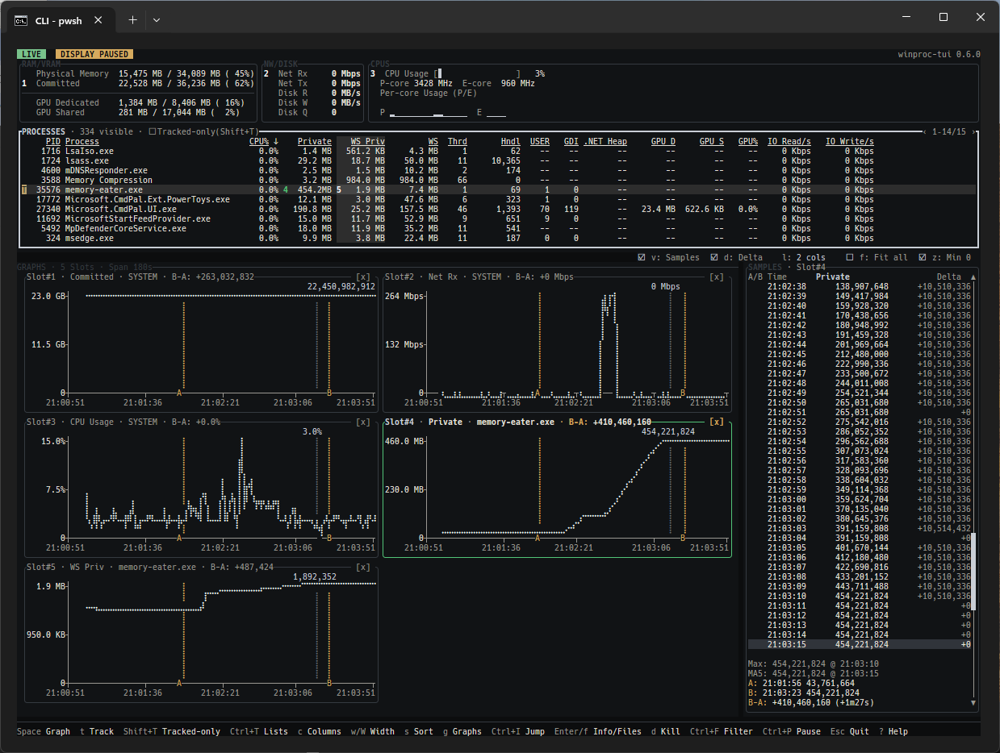
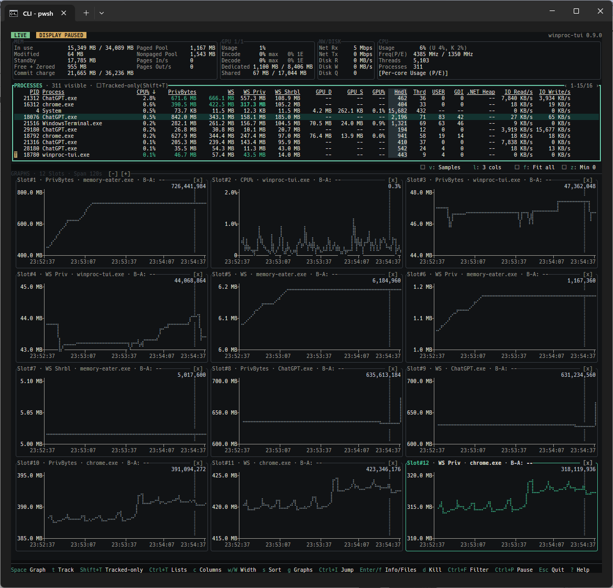
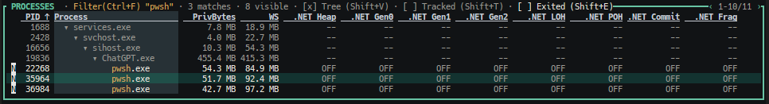
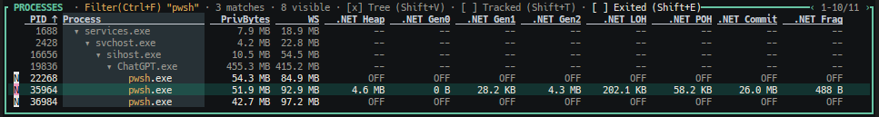

# winproc-tui

[](LICENSE)
[](#動作環境)
[](https://www.rust-lang.org/)

言語: [English](README.md) | [日本語](README.ja.md)

`winproc-tui` は、Windows 11 向けの軽量なプロセスモニタリングツールです。Rust で実装されており、CPU 使用率とメモリ使用量を抑えながら、軽快に動作します。

システム全体とプロセスごとの複数のメトリクスを監視し、リソース使用量の推移を可視化して、プロセスの挙動をターミナル上で調査できます。アプリケーションのメモリ、ハンドル、GUI リソース、GPU メモリ、I/O、.NET ランタイムなどに関する各種メトリクスの変化を時系列で追跡できます。

必要なメトリクスを最大 16 個の Graph に並べ、A/B マーカーで正確に比較し、セッションを記録してあとから調査できます。汎用的なシステム管理ではなく、開発・検証中に選択したプロセスを素早く繰り返し調べることに特化しています。



_`memory-eater.exe` の `Private Bytes` をグラフで表示し、A 地点から B 地点までの変化量を確認している例です。_

## インストール

Windows 用の公式バイナリの公開先は、[TX230/winproc-tui Releases](https://github.com/TX230/winproc-tui/releases) のみです。WinGet と [TX230 Scoop Bucket](https://github.com/TX230/scoop-bucket) は、どちらも同じ Release バイナリをインストールします。これら以外の配布元から入手したバイナリは、公式ビルドではありません。

### WinGet

```powershell
winget install winproc-tui
winproc-tui
```

更新とアンインストール:

```powershell
winget upgrade winproc-tui
winget uninstall winproc-tui
```

パッケージ ID を厳密に指定する場合は、上記の各 `winget` コマンドにある `winproc-tui` を `--id TX230.winproc-tui -e` に置き換えます。

### Scoop

```powershell
scoop bucket add tx230 https://github.com/TX230/scoop-bucket
scoop install tx230/winproc-tui
winproc-tui
```

登録済み Bucket を更新してから、アプリを更新します。

```powershell
scoop update
scoop update winproc-tui
```

アンインストールには `scoop uninstall winproc-tui` を使用します。通常は保存済み設定が保持されます。設定も削除する場合は `scoop uninstall --purge winproc-tui` を使用してください。

## クイックスタート

### プロセスの変化を Graph で見る

1. `PROCESSES` で調べたいプロセスを選びます。
2. `Left` / `Right` で `PrivBytes` などのメトリクスカラムを選びます。
3. `Space` を押すかメトリクスセルをダブルクリックして Graph を追加します。同じ操作をほかのメトリクスでも繰り返すと、最大 16 個の Graph を同じワークスペースで比較できます。

システムの MEM、GPU、CPU、ネットワーク / ディスクは、Tracking List に登録しなくても各パネルから直接 Graph に追加できます。



_レイアウトを変更し、12 個の Graph を表示している例です。_

### 2 時点を比較する

Graph または Samples にフォーカスを移し、`Left` / `Right` でサンプルを選びます。開始点で `a`、終了点で `b` を押すと、値の差と経過時間を確認できます。`x` で比較を解除します。

### プロセスを追跡・記録する

1. Process または PID セルを選び、`Space` または `t`、あるいは右クリックメニューの **Track process** でプロセス名を作業中の Tracking List へ追加します。
2. `Ctrl+T` から保存済み Investigation Profile を開けます。`Ctrl+S` で現在の Profile を上書き保存し、作業中の Tracking List に新しい名前を付けるときは `Investigation > Save profile as…` を使います。
3. `Ctrl+R` を押し、保存先と `1s` / `2s` / `5s` / `10s` の記録間隔を選んで開始します。
4. もう一度 `Ctrl+R` を押し、`y` で記録を終了します。`Enter`、`Esc`、`n` では記録を継続します。
5. `Ctrl+L` から保存済みログを開き、あとから調査します。

記録には Tracking List へのプロセス名の登録が 1 件以上必要ですが、一致するプロセスがまだ起動していなくても開始できます。対象名は記録開始時に確定し、そのセッション中は変わりません。`Shift+T` の All processes / Tracked-only 切り替えは表示だけを変更するため、記録中も使用できます。

`Tab` / `Shift+Tab` でパネルを移動し、方向キーで行、カラム、サンプルを選びます。`F1` または `?` で全操作を確認でき、Footer には現在の状況で使える主要操作が表示されます。

### .NETメトリクスを収集する

**.NET 8 / 9 / 10には、アプリの初期化中にメトリクス収集を開始すると、そのアプリがハングする可能性があるランタイムの不具合があります。** 起動時の自動接続を避けるため、winproc-tuiは毎回、収集が無効な状態で起動します。

1. 対象アプリの初期化が完了したことを確認します。
2. PROCESSESで対象プロセスを選択し、`n`を押して収集を開始します。
3. もう一度`n`を押すと、そのプロセスの収集を停止します。

トラッキングリストへの登録は不要です。COLUMNSで.NET列を選択しても、表示が変わるだけで収集は始まりません。新しく起動したプロセスや再起動したプロセスは、改めて収集を開始してください。

**.NET Frameworkアプリは今回の問題の対象外です。** 対応するメトリクスは、開始操作なしでPDHを通じて従来どおり自動収集します。

手動で開始する場合も、初期化中の収集には同じ危険があります。この対策は自動接続を防ぐもので、ランタイムの不具合そのものを修正するものではありません。関連するランタイムの報告や収集の制約は[.NET収集仕様](docs/dotnet-metrics-collection.md)を参照してください。



_収集開始前は、.NET列にOFFが表示されます。_



_nを押すと、選択したプロセスに測定値が表示されます。ほかのプロセスはOFFのままです。Nは開始要求を受け付けた時点でピンク背景に変わるため、最初の測定値が届く前にもピンクになります。_

## 主な機能

- **CSV 出力**: **File > Export Graphs to CSV** から、登録したすべての Graph を 1 つの CSV に出力できます。保持している履歴全体、表示中の時間範囲、A/B 間から出力範囲を選べます。
- **ライブモニタリング**: システムのメモリ負荷、GPU アダプター別の負荷とメモリ、ネットワーク / ディスク、CPU、プロセス別の詳細メトリクスを表示します。
- **プロセスツリー**: Processes をソート可能なフラット一覧と、各ライブスナップショットで取得した親子関係のツリーに切り替え、フィルターやサブツリーの折りたたみを利用できます。
- **Graph と A/B 比較**: 最大 16 個のメトリクスを並び順を変えられるワークスペースに配置し、連動する Samples を使って選んだ 2 つのサンプル時刻のメトリクス値を比較します。
- **Investigation Profiles**: あとから起動するプロセスも調査できるよう、Tracking List に名前を付けて保存します。追跡対象のプロセスが終了したあとも、最後に取得したメトリクス値を保持します。
- **.NET メトリクス**: .NET 8 / 9 / 10はプロセスごとに収集を開始でき、.NET Frameworkの対応するメトリクスは自動収集します。起動時の注意事項と操作手順は[.NETメトリクスを収集する](#netメトリクスを収集する)を参照してください。
- **Process Info**: 選択したプロセスのメトリクス、イメージとランタイム、開いているファイル、DLL、環境変数、ネットワークのアドレスとポート、スレッド一覧と優先割り当て先 CPU を 1 つのダイアログから調査できます。Scheduling タブでは CPU の優先度と、プロセッサグループが 1 つの環境での CPU アフィニティを確認・変更し、その場で適用したり直前の値に戻したりできます。
- **ファイルを使用中のプロセス検索**: ファイル名やパスから、そのファイルを開いているプロセスを検索できます。検索結果から Process Info の Files タブに移動し、ハンドルやアクセス権などを詳しく調べられます。
- **ネットワークの調査**: **Investigation > Network endpoints**（**F3**）からシステム全体の TCP/UDP のアドレス、ポート、所有プロセスを確認し、Process Info に移動できます。ビューを切り替えても一覧とフィルターを保持します。一覧は操作時に取得し、レコーディングには含めません。
- **記録と Log view**: システムメトリクスに加え、Tracking List の登録名に一致するプロセスを JSON Lines 形式で記録し、Log view の Processes、Graph、Samples、A/B 比較を使ってあとから調査できます。

前回の Tracking List とアプリ全体の設定は次回起動時に復元されます。起動時に保存済み Investigation Profile または空の Tracking List を選ぶこともできます。Graph は次回起動時に復元されず、フィルター入力と実行時のプロセス識別子も保存しません。

## 向いている用途

`winproc-tui` は次のような調査に適しています。

- プロセスのリソース使用量を把握し、最適化の余地を調べる。
- メモリやハンドルなどのリソースリークがないか調べる。
- `Private Bytes` と `Working Set - Private` の差から、大きなバッファを確保したまま使っていない可能性を調べる。
- ハンドル数の推移と Process Info の Files を確認し、ファイルの閉じ忘れがないか調べる。各ファイルハンドルのキャッシュ設定、Write-through、同期・非同期対応、アクセス権も確認できます。
- プロセスが読み込んでいる DLL のパスやバージョンを調べる。
- **Investigation > Find processes by file**（**F4**）からファイル名やパスで使用中のプロセスを検索し、そのプロセスの Files タブで詳しく調べる。検索できなかった範囲も確認できます。
- 特定の処理やコード変更の前後でリソース使用量を比較する。
- 対象プロセスを記録し、現象が発生した時点付近の履歴をあとから調べる。

## 記録と Log view

記録対象の名前は、開始時点の作業中 Tracking List に固定されます。一致するプロセスが実行されていなくても、システムのメモリ、GPU アダプター別メトリクス、CPU 集計値、ネットワーク / ディスクは記録され、プロセス一覧だけが空になります。

Live でのデータ収集とサンプル履歴は、常に 1 秒間隔です。記録間隔を長くすると、取得できたサンプルが平均化されるため、ファイルサイズと Log view の読み込み負荷が減る一方、短時間のスパイクは平滑化されます。1 回の記録は最大 24 時間で、上限に達すると自動的に Live へ戻ります。

Log view ではフレームは再生されず、プロセスの最終スナップショットが表示されます。記録済みの履歴は、Graph、Samples、Process Info、A/B 比較を使って調査できます。記録と Log view は同時に使用できません。

メトリクスの定義、集約方法、記録フォーマットは [docs/metrics.md](docs/metrics.md) を参照してください。

## 動作環境

- Windows 11 x64 のみ。Linux と macOS には対応していません。

通常の監視に管理者権限は不要です。保護されたプロセスでは、Process Info の一部や開いているファイルの一覧を取得できない場合があり、取得できない値は `--` で表示されます。

同じ Windows セッション内で起動できる `winproc-tui` は 1 つだけです。後から起動した `winproc-tui` は、起動元のターミナルの表示や保存済みのセッション設定を変更せずに終了します。

## ソースからビルドする

ビルドには Rust 1.95.0 以降、Rust 2024 edition のツールチェイン、Build Tools for Visual Studio 2026 の MSVC リンカーが必要です。[rustup](https://rustup.rs/) で Rust を導入してからビルドします。

```powershell
git clone https://github.com/TX230/winproc-tui.git
cd winproc-tui
cargo build --release
.\target\release\winproc-tui.exe
```

Rust 開発者は、crates.io で公開されたソースパッケージをインストールできます。Cargo が手元でビルドするため、GitHub Releases で公開されるビルド済み Windows バイナリとは別の導入方法です。

```powershell
cargo install winproc-tui --locked
```

代わりに、現在のチェックアウトをインストールする場合:

```powershell
cargo install --path . --locked
```

## 詳細情報

- アプリ内で `F1` または `?` を押すと、キーボードとマウスの全操作を確認できます。
- `winproc-tui --help` で起動オプションを確認できます。
- [docs/metrics.md](docs/metrics.md): メトリクス、取得元、表示形式、記録ログ。
- [docs/architecture.md](docs/architecture.md): システム全体の構成と、機能別設計書へのリンク。

## バグ報告・要望

不具合報告と機能要望は [GitHub Issues](https://github.com/TX230/winproc-tui/issues) へお願いします。Issue は日本語と英語のどちらでも構いません。

セキュリティ脆弱性の疑いがある場合は、公開 Issue ではなく [SECURITY.md](SECURITY.md) の手順で非公開報告してください。

個人開発のプロジェクトのため、外部コントリビューターからの Pull Request は、事前に依頼したものを除き受け付けていません。Issue の作成や議論は、Pull Request の依頼を意味しません。詳細は [CONTRIBUTING.md](CONTRIBUTING.md) を参照してください。

## ライセンス

MIT License。詳細は [LICENSE](LICENSE) を参照してください。
