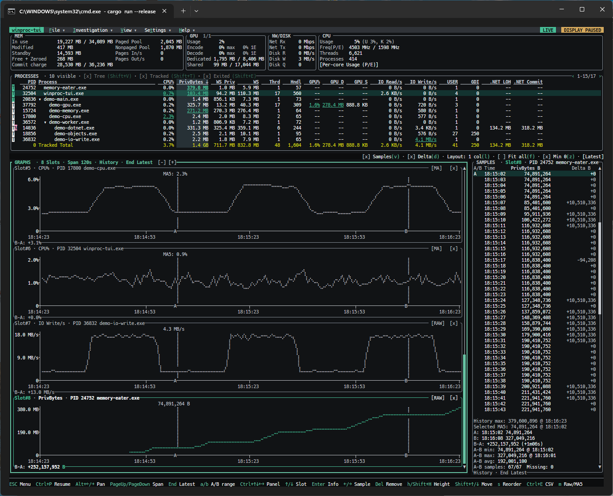
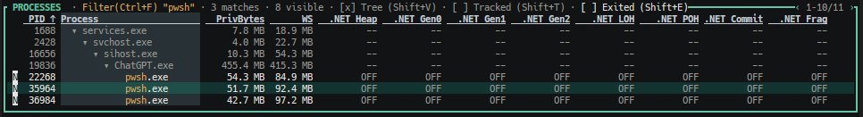
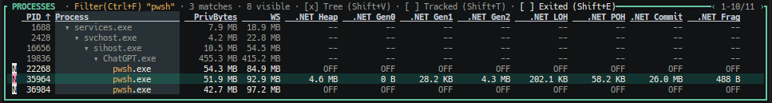
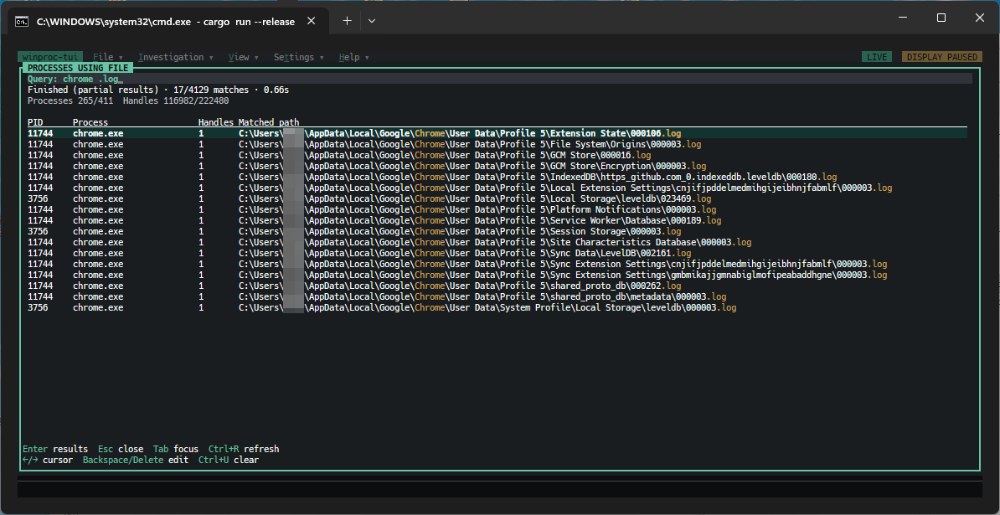
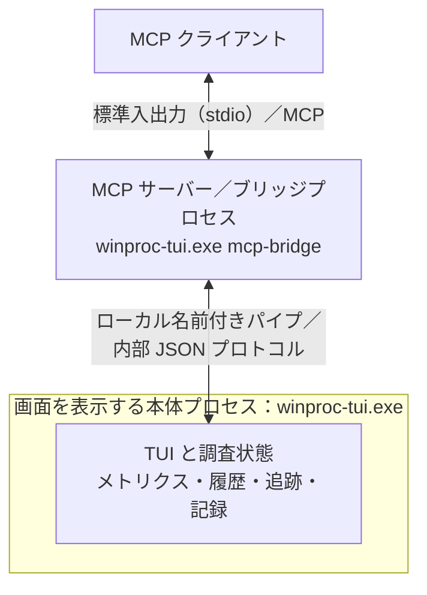

# winproc-tui

[](LICENSE)
[](#動作環境)
[](https://www.rust-lang.org/)

言語: [English](README.md) | [日本語](README.ja.md)

winproc-tui は、Windows 11 向けの高速で軽量なプロセス監視ツールです。Rust と Ratatui で実装され、ターミナル上で動作します。

システム全体と個別のプロセスについて、PDH では取得できない .NET 8/9/10 のランタイム情報を含む様々なメトリクスを収集し、その推移を追跡します。最大 16 個の Graph スロットを用いた同時監視、A/B マーカーによる 2 時点間の変化量測定、セッションの記録と再調査が可能です。このほか、読み込まれている DLL、開いているファイル、使用中のネットワークポートの確認や、特定のファイルを開いているプロセスの検索にも対応しています。デバッグに役立つ機能として、選択したプロセスの強制終了や、優先度・CPU アフィニティの変更なども備えます。また、実験的機能として MCP（Model Context Protocol）に対応しており、AI アシスタントからメトリクスの取得やプロセスの調査を行えます。

本ツールは、特に開発・検証中に特定のプロセスを素早く、繰り返し調べることを得意としています。



_`memory-eater.exe` の `Private Bytes` をグラフで表示し、A 地点から B 地点までの変化量を確認している例です。_

## インストール

Windows 用の公式バイナリの公開先は、[TX230/winproc-tui Releases](https://github.com/TX230/winproc-tui/releases) のみです。WinGet と [TX230 Scoop Bucket](https://github.com/TX230/scoop-bucket) は、どちらも同じ Release バイナリをインストールします。これら以外の配布元から入手したバイナリは、公式ビルドではありません。

### WinGet

```powershell
winget install winproc-tui
```

WinGet で winproc-tui を初めてインストールした場合は、環境変数 PATH の変更を反映するため、一度ターミナルを閉じてから、もう一度起動してください。2 回目以降のインストールでは、この作業は不要です。

```powershell
winproc-tui
```

更新とアンインストール:

```powershell
winget upgrade winproc-tui
winget uninstall winproc-tui
```

パッケージ ID を厳密に指定する場合は、上記の各 `winget` コマンドにある `winproc-tui` を `--id TX230.winproc-tui -e` に置き換えます。

### Scoop

```powershell
scoop bucket add tx230 https://github.com/TX230/scoop-bucket
scoop install tx230/winproc-tui
winproc-tui
```

登録済み Bucket を更新してから、アプリを更新します。

```powershell
scoop update
scoop update winproc-tui
```

アンインストールには `scoop uninstall winproc-tui` を使用します。通常は保存済み設定が保持されます。設定も削除する場合は `scoop uninstall --purge winproc-tui` を使用してください。

## クイックスタート

### プロセスの変化を Graph で見る

1. `PROCESSES` パネルにフォーカスを移します。`Tab` でフォーカスを順に移動するか、`Ctrl+↑/↓/←/→` でその方向にある隣のパネルへ移動できます。パネル内をマウスでクリックして移動することもできます。
2. `↑` / `↓` またはマウスクリックで、調べたいプロセスを選びます。
3. `Left` / `Right` で `PrivBytes` などのメトリクスの列を選びます。
4. `Space` を押すかメトリクスセルをダブルクリックして Graph を追加します。同じ操作をほかのメトリクスでも繰り返すと、最大 16 個の Graph を同じワークスペースで比較できます。

Commit charge などのシステムメトリクスも同様にグラフ化できます。

### 2 時点を比較する

Graph または Samples にフォーカスを移し、`Left` / `Right` でサンプルを選びます。開始点で `a`、終了点で `b` を押すと、値の差と経過時間を確認できます。`x` で比較を解除します。

### プロセスを追跡・記録する

プロセスを追跡対象にすると、メトリクスの数値履歴をメモリ上に約 2 時間分（1 秒間隔で最大 7,200 サンプル）保持します。未追跡のプロセスは約 2 分分（最大 120 サンプル）です。追跡対象のプロセスの子プロセス（孫以降も含む）も、検出されると自動的に追跡対象になります。アプリを終了した後も履歴を調査したい場合は、別途ログへの記録を開始してください。

1. Process または PID セルを選び、`Space` または `t`、あるいは右クリックメニューの **Track process** でプロセス名を現在の Tracking List に追加します。
2. `Ctrl+T` から保存済み Investigation Profile を開けます。`Ctrl+S` で現在の Profile を上書き保存し、現在の Tracking List を新しい Profile として保存するときは `Investigation > Save profile as…` を使います。
3. `Ctrl+R` を押し、保存先と `1s` / `2s` / `5s` / `10s` の記録間隔を選んで開始します。
4. もう一度 `Ctrl+R` を押し、`y` で記録を終了します。`Enter`、`Esc`、`n` では記録を継続します。
5. `Ctrl+L` から保存済みログを開き、あとから調査します。

記録には Tracking List へのプロセス名の登録が 1 件以上必要ですが、一致するプロセスがまだ起動していなくても開始できます。対象名は記録開始時に確定し、そのセッション中は変わりません。`Shift+T` の All processes / Tracked-only 切り替えは表示だけを変更するため、記録中も使用できます。

`Tab` / `Shift+Tab` でパネルを移動し、方向キーで行、列、サンプルを選びます。`F1` または `?` で全操作を確認でき、画面下部には、その場で使える主な操作が表示されます。

### .NET メトリクスを収集する

**.NET 8/9/10 には、アプリの初期化中にメトリクス収集を開始すると、そのアプリがハングする可能性があるランタイムの不具合があります。** 起動時の自動接続を避けるため、winproc-tui は毎回、収集が無効な状態で起動します。

1. 対象アプリの初期化が完了したことを確認します。
2. PROCESSES で対象プロセスを選択し、`n` を押して収集を開始します。
3. もう一度 `n` を押すと、そのプロセスの収集を停止します。

トラッキングリストへの登録は不要です。COLUMNS で .NET 列を選択しても、表示が変わるだけで収集は始まりません。新しく起動したプロセスや再起動したプロセスは、改めて収集を開始してください。

**.NET Framework アプリは今回の問題の対象外です。** 対応するメトリクスは、開始操作なしで PDH を通じて従来どおり自動収集します。

手動で開始する場合も、初期化中の収集には同じ危険があります。この対策は自動接続を防ぐもので、ランタイムの不具合そのものを修正するものではありません。関連するランタイムの報告や収集の制約は [.NET 収集仕様](docs/dotnet-metrics-collection.md) を参照してください。



_収集開始前は、.NET 列に OFF が表示されます。_



_`n` を押すと、選択したプロセスに測定値が表示されます。ほかのプロセスは OFF のままです。N は開始要求を受け付けた時点でピンク背景に変わるため、最初の測定値が届く前にもピンクになります。_

## 主な機能

### 監視する

- **システムとプロセスのメトリクス**: CPU、メモリ、GPU（アダプター別）、ネットワーク / ディスクの全体状況と、プロセスごとの詳細なメトリクスをリアルタイムに表示します。
- **一覧とツリー表示**: PROCESSES は、ソートできるフラット一覧と親子関係を示すツリー表示を切り替えられます。フィルターとサブツリーの折りたたみにも対応しています。
- **.NET メトリクス**: .NET 8/9/10 はプロセスごとに収集を開始でき、.NET Framework は自動で収集します。起動時の注意事項は [.NET メトリクスを収集する](#net-メトリクスを収集する) を参照してください。

### 可視化・比較する

- **Graph Workspace**: 最大 16 個のメトリクスを共通の時間軸で並べて表示し、自由に並べ替えられます。Graph は起動ごとに空の状態から始まります。
- **Samples と A/B 比較**: Graph と連動する数値履歴で、2 時点の差分と経過時間、選択中の Graph の A/B 区間における最小値・最大値・平均値を確認できます。
- **CSV 出力**: **File > Export Graphs to CSV** から、登録した Graph を 1 つの CSV に出力できます。出力範囲は、履歴全体、表示範囲、A/B 区間から選べます。

### 調べる

- **Process Info**: 実行ファイル、開いているファイル、DLL、環境変数、ネットワークポート、スレッドを 1 つのダイアログで確認できます。CPU 優先度とアフィニティも変更できます。
- **ファイルからプロセスを逆引き**: **Investigation > Find processes by file** または `F4` から、ファイル名やパスの一部を入力して、そのファイルを開いているプロセスを探せます。たとえば `.log` と入力すると、システム全体で開かれている `.log` ファイルと、それを開いているプロセスが一覧表示されます。検索は通常 1 秒以内に完了します。アクセスできないプロセスは調べられないため、結果が 0 件でも、そのファイルを開いているプロセスがないとは限りません。
- **ネットワークエンドポイント**: **Investigation > Network endpoints** または `F3` から、システム全体の TCP/UDP のアドレスとポートを一覧表示し、使用しているプロセスの詳細を開けます。



_`chrome .log` で検索し、両方の語を含むパスのファイルと、それを開いているプロセスを 0.66 秒で列挙した例です。_

### 追跡・記録する

- **プロセス群の追跡**: アプリのプロセス名を Tracking List に登録すると、確認できた子孫プロセスもまとめて追跡します。子孫と同じ名前でも、親子関係のないプロセスは対象に含めません。
- **Investigation Profile**: Tracking List に名前を付けて保存し、同じアプリの調査をすぐに始められます。前回終了時の Tracking List は次回起動時に復元され、起動時に保存済み Profile を選ぶこともできます。
- **記録と Log view**: 追跡対象とシステムのメトリクスを JSON Lines 形式で記録し、あとから Graph や A/B 比較で調べられます。詳しくは [記録と Log view](#記録と-log-view) を参照してください。

## 向いている用途

開発中やテスト中の、次のような調査に向いています。

- **メモリやハンドルが増え続ける**: Private Bytes、ハンドル数、USER / GDI オブジェクト数、GPU メモリの推移を並べて、リークの兆候を調べます。.NET アプリでは、その増加がマネージドヒープの増加を伴っているかも確認できます。
- **確保したメモリが使われているか確かめたい**: `Private Bytes` と `Working Set - Private` の差は、コミット済みのメモリのうち、物理メモリに載っていない分の目安になります。差が大きい場合は、確保したまま触れていないバッファがある可能性があります。
- **操作の影響を数値で確かめたい**: 操作の前後に A/B マーカーを置き、増減量、経過時間、区間内の最小値・最大値・平均値を確認します。コード変更の前後で比べる場合は、それぞれの結果を CSV に出力して比較できます。
- **複数プロセスで動くアプリ全体の使用量を知りたい**: 起動元のプロセス名を Tracking List に登録すると、子孫プロセスもまとめて追跡し、合計値を表示します。
- **起動直後や終了間際、再現しにくい現象を調べたい**: 対象の起動前から記録を始められます。追跡中のプロセスは、終了後も最後に取得できた値と履歴が残ります。最大 24 時間の記録から、現象が起きた時刻付近をあとから調べられます。ただし、収集間隔より短い変化は記録されない場合があります。
- **ファイルが使用中で削除・上書きできない**: ファイル名やパスの一部から、そのファイルを開いているプロセスを探し、アクセス権などを確認します。
- **ファイルの閉じ忘れや開き方を確認したい**: ハンドル数の推移と開いているファイルの一覧から、閉じ忘れの可能性があるファイルを探します。各ハンドルのキャッシュ設定、Write-through、非同期 I/O への対応、アクセス権も確認できます。
- **ポートが使用中でサーバーを起動できない**: そのポートを使っているプロセスを特定します。
- **想定と違うビルドや設定で動いている疑いがある**: 実行ファイルと読み込まれた DLL のパスやバージョン、コマンドライン、環境変数を確認します。

関数単位の CPU プロファイリングや呼び出し履歴の取得、リモート監視、常駐して長期間のデータを蓄積する運用監視には、専用のツールを使ってください。

## 記録と Log view

記録の基点となる名前は、記録開始時点の Tracking List に固定されます。確認できた子孫も対象になり、親が先に終了しても追跡を続けます。子孫も含めて対象が実行されていない場合でも、システムのメモリ、GPU アダプター別メトリクス、CPU 集計値、ネットワーク / ディスクは記録され、プロセス一覧だけが空になります。

Live でのデータ収集とサンプル履歴は、常に 1 秒間隔です。記録間隔を長くすると、取得できたサンプルが平均化されるため、ファイルサイズと Log view の読み込み負荷が減る一方、短時間のスパイクは平滑化されます。1 回の記録は最大 24 時間で、上限に達すると自動的に Live へ戻ります。

Log view では、ログに保存されたプロセスの最後の状態が表示されます。記録した内容を時系列に沿って再生する機能はありません。記録済みの履歴は、Graph、Samples、Process Info、A/B 比較を使って調査できます。記録と Log view は同時に使用できません。

メトリクスの定義、集約方法、記録フォーマットは [docs/metrics.md](docs/metrics.md) を参照してください。

## ローカル MCP 連携

**MCP 連携は実験的な機能です。**

MCP クライアントには `winproc-tui mcp-bridge` を登録してください。クライアントが起動するブリッジプロセスが、MCP サーバーとして動作します。ブリッジと画面を表示する本体は、同じ `winproc-tui.exe` を別々のプロセスとして実行します。TUI、メトリクス、履歴、調査状態は本体が管理します。

MCP クライアントの接続ごとに、専用の MCP サーバー（ブリッジ）プロセスが起動します。複数のブリッジは、同じ Windows セッション内の 1 つの本体プロセスを共有し、最大 4 接続まで同時に利用できます。たとえば、2 つの MCP クライアントが接続すると、ブリッジは 2 プロセス、本体は 1 プロセスになります。本体の現在の調査状態、メトリクス、履歴、記録状態を共有するため、クライアントごとに別の TUI や調査状態が用意されるわけではありません。

Codex では、`codex` と `winproc-tui` に PATH が通っている状態で、次のコマンドを実行してサーバーを登録し、登録内容を確認します。

```powershell
codex mcp add winproc -- winproc-tui mcp-bridge
codex mcp list
```

`winproc-tui` に PATH が通っていない場合は、登録コマンドの `winproc-tui` を、二重引用符で囲んだ `winproc-tui.exe` のフルパスに置き換えてください。

Codex から MCP サーバーの登録を解除するには、次のコマンドを実行します。

```powershell
codex mcp remove winproc
```

削除されるのは Codex の MCP 設定だけで、`winproc-tui` 本体はアンインストールされません。ほかの MCP クライアントでは、そのクライアントの設定から該当するサーバーの登録を削除してください。

最初の有効なツール呼び出しで、ブリッジは次のように接続します。

- **WinProc TUI が起動済みの場合**: そのプロセスに接続し、現在の調査状態を共有します。既存のウィンドウをそのまま使い、TUI を追加で起動しません。
- **WinProc TUI が未起動の場合**: Windows Terminal の新しいウィンドウに本体を起動してから接続します。起動と接続の待機は最大 12 秒です。自動起動には Windows Terminal、`wt.exe` のアプリ実行エイリアス、保存済み設定で MCP 接続が有効になっていることが必要です。

MCP の初期化やツール一覧の取得（`tools/list`）だけでは、TUI の起動や接続は行いません。起動済みの本体が MCP 接続を受け付けられない場合は、別の本体を起動せず、エラーを返します。本体とブリッジは同じ Windows ログオンセッション、同じ権限レベルで実行します。



図は、既存の本体への接続、または本体の自動起動が完了した後の構成です。MCP 通信に TCP/IP は使用しません。調査対象のファイルがネットワーク共有にある場合は、通常の Windows の権限に従ってアクセスできます。

本体への接続中は、TUI 画面の右上、**LIVE**・**REC**・**LOG** のすぐ左に黄色の **MCP** マークが表示されます。ツールを呼び出していない間も表示され、最後のクライアントが切断すると消えます。ウィンドウ幅が極端に狭い場合は、動作モードや更新遅延・表示停止の表示が優先されます。MCP クライアントが切断しても、本体と実行中の記録は継続します。

MCP 接続は初期設定で有効です。Settings の **Disable MCP connections** をオンにすると、サンプリングや記録を続けたままクライアントを切断し、外部からの接続を無効にできます。保存済み設定で MCP が無効な場合は、TUI を手動で起動して有効にしてください。起動時にプロファイル選択画面が表示された場合も、選択を終えてからツール呼び出しを再試行します。

通常のブリッジは結果を最大 5 秒待ち、最後のページを返す際に一時データを解放します。続きが必要な場合は、次の呼び出しを結果に含めます。非同期ジョブや一時データの寿命をクライアント側で管理する場合は、`winproc-tui mcp-bridge --raw` を使用できます。

`tools/list` で、メトリクスと履歴、プロセス・ファイル調査、追跡とプロファイル、記録、保存ログの独立した分析、.NET 収集の操作、条件待機、グラフ操作と CSV 出力の全 29 ツールを確認できます。指定したシステム・プロセスのメトリクスをグラフに追加し、登録済みグラフをまとめて指定ディレクトリへ CSV 出力できます。追加と出力を 1 回の呼び出しで行うこともできます。記録・ログ関連機能を使う前に、TUI で記録先を設定してください。確認が必要な操作は TUI に表示されます。[仕様書](docs/mcp-integration-specification.md) と [検証結果](docs/mcp-system-testing.md) も参照してください。

## 動作環境

- Windows 11 x64 のみ。Linux と macOS には対応していません。

通常の監視に管理者権限は不要です。保護されたプロセスでは、Process Info の一部や開いているファイルの一覧を取得できない場合があり、取得できない値は `--` で表示されます。

同じ Windows セッション内で起動できる `winproc-tui` は 1 つだけです。後から起動した `winproc-tui` は、起動元のターミナルの表示や保存済みのセッション設定を変更せずに終了します。

## ソースからビルドする

ビルドには Rust 1.95.0 以降、Rust 2024 edition のツールチェイン、Build Tools for Visual Studio 2026 の MSVC リンカーが必要です。[rustup](https://rustup.rs/) で Rust を導入してからビルドします。

```powershell
git clone https://github.com/TX230/winproc-tui.git
cd winproc-tui
cargo build --release
.\target\release\winproc-tui.exe
```

Rust 開発者は、crates.io で公開されたソースパッケージをインストールできます。Cargo が手元でビルドするため、GitHub Releases で公開されるビルド済み Windows バイナリとは別の導入方法です。

```powershell
cargo install winproc-tui --locked
```

手元のソースコードからインストールする場合は、次のコマンドを実行します。

```powershell
cargo install --path . --locked
```

## 詳細情報

- アプリ内で `F1` または `?` を押すと、キーボードとマウスの全操作を確認できます。
- `winproc-tui --help` で起動オプションを確認できます。

機能の詳細は、以下のドキュメントを参照してください。リンク先の仕様書は英語です。

- [docs/metrics.md](docs/metrics.md)：指標の意味、取得元、表示形式、記録形式。
- [docs/tracking-and-history.md](docs/tracking-and-history.md)：追跡対象、子プロセスの自動追跡、履歴の保持。
- [docs/graph-workspace.md](docs/graph-workspace.md)：グラフ、Samples、A/B 比較。
- [docs/process-investigation.md](docs/process-investigation.md)：ファイル、DLL、環境変数、ネットワークなどの調査。
- [docs/recording-and-log-view.md](docs/recording-and-log-view.md)：記録の動作、保存ログの読み込みと閲覧。
- [docs/dotnet-metrics-collection.md](docs/dotnet-metrics-collection.md)：対応ランタイム、収集方法、制約。
- [docs/mcp-integration-specification.md](docs/mcp-integration-specification.md)：接続方法、ツールの仕様、制約。
- [docs/architecture.md](docs/architecture.md)：内部構成、各機能の役割、データの流れ。

## バグ報告・要望

不具合報告と機能要望は [GitHub Issues](https://github.com/TX230/winproc-tui/issues) へお願いします。Issue は日本語と英語のどちらでも構いません。

セキュリティ脆弱性の疑いがある場合は、公開 Issue ではなく [SECURITY.md](SECURITY.md) の手順で非公開報告してください。

個人開発のプロジェクトのため、外部コントリビューターからの Pull Request は、事前に依頼したものを除き受け付けていません。Issue の作成や議論は、Pull Request の依頼を意味しません。詳細は [CONTRIBUTING.md](CONTRIBUTING.md) を参照してください。

## ライセンス

MIT License。詳細は [LICENSE](LICENSE) を参照してください。
