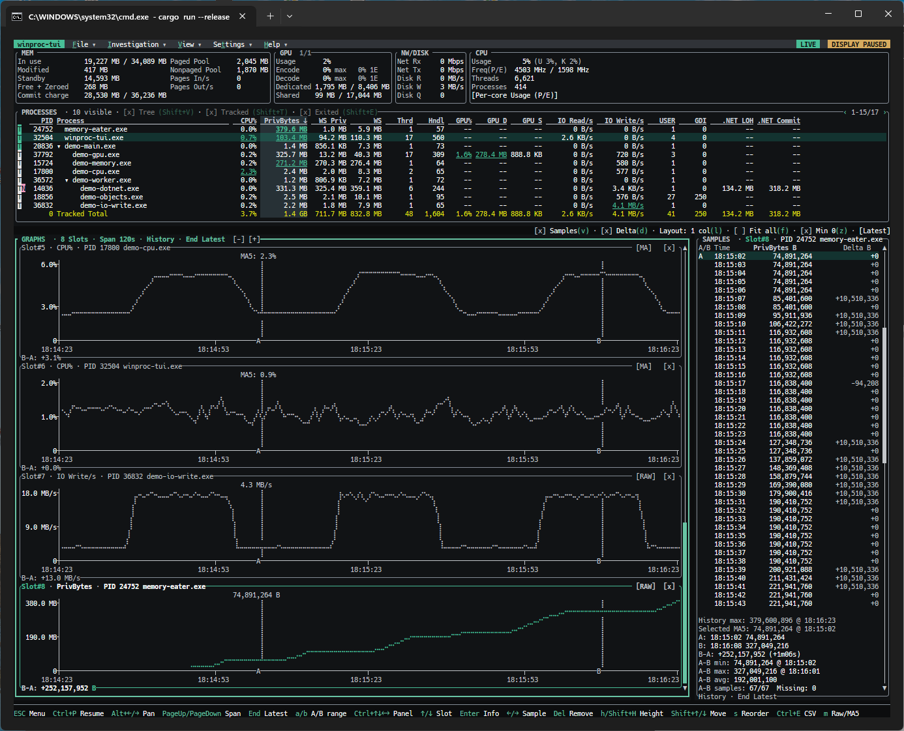
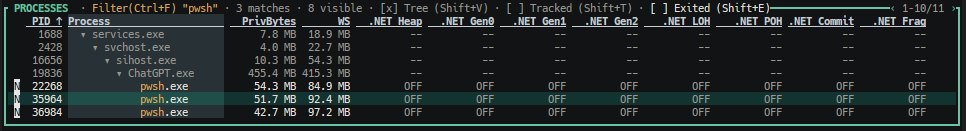
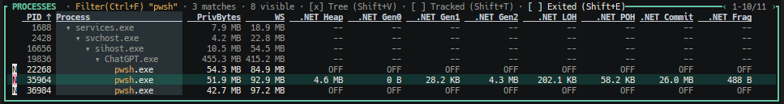
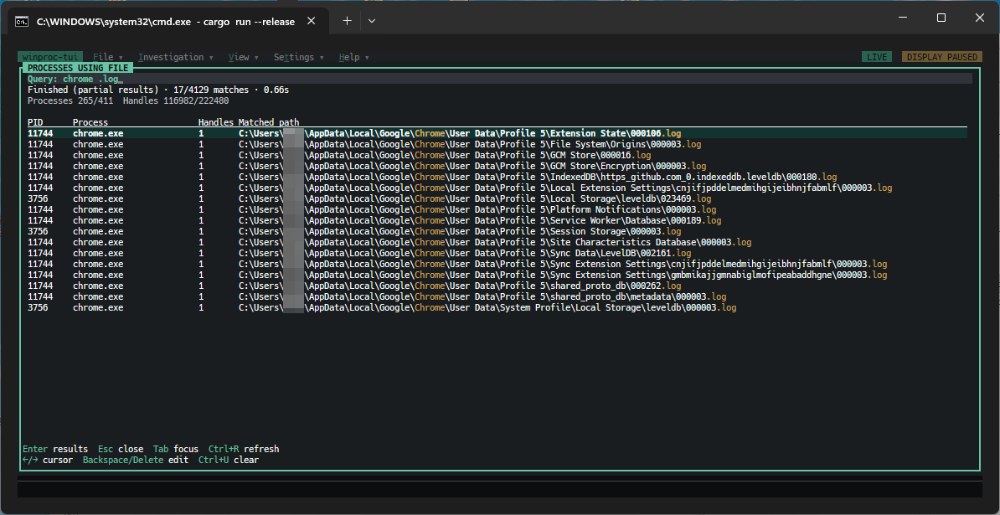
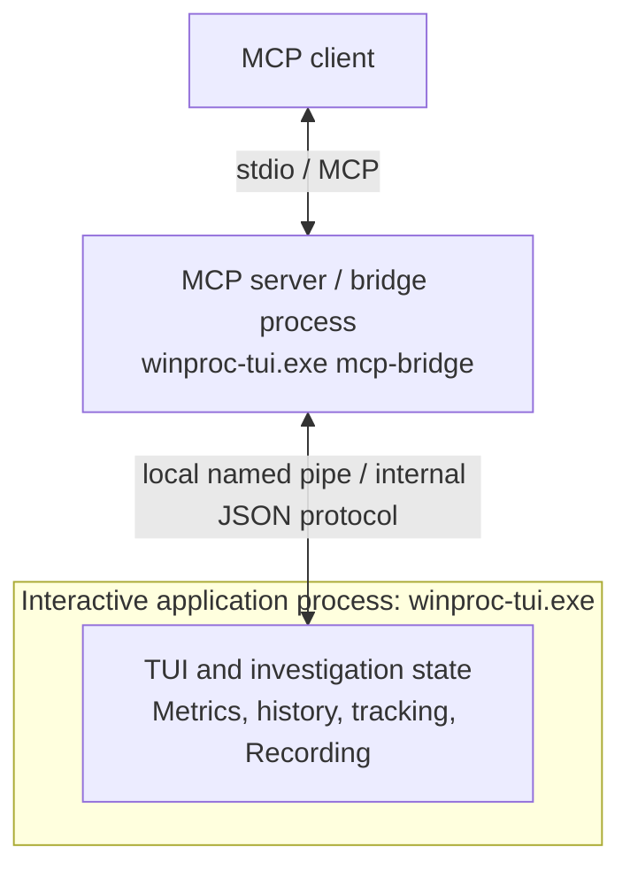

# winproc-tui

[](LICENSE)
[](#requirements)
[](https://www.rust-lang.org/)

Language: [English](README.md) | [日本語](README.ja.md)

winproc-tui is a fast, lightweight terminal process monitor for Windows 11, built with Rust and Ratatui.

It collects a wide range of system-wide and per-process metrics, including .NET 8/9/10 runtime information that is not available through PDH, and tracks how they change over time. It supports simultaneous monitoring with up to 16 Graph slots, measuring the change between two points in time with A/B markers, and recording sessions for later investigation. You can also inspect the DLLs a process has loaded, the files it has open, and the network ports it is using, or search for processes that have a specific file open. For debugging, it provides operations such as killing a selected process and changing its priority or CPU affinity. As an experimental feature, it supports MCP (Model Context Protocol), allowing AI assistants to retrieve metrics and investigate processes.

winproc-tui is especially well suited to quick, repeated investigation of specific processes during development and testing.



_The `Private Bytes` graph for `memory-eater.exe`, showing the change from point A to point B._

## Install

Official Windows binaries are published only on [TX230/winproc-tui Releases](https://github.com/TX230/winproc-tui/releases). WinGet and the [TX230 Scoop Bucket](https://github.com/TX230/scoop-bucket) install those same binaries. Copies, mirrors, and modified repositories are not official builds.

### WinGet

```powershell
winget install winproc-tui
```

After installing winproc-tui with WinGet for the first time, close and reopen your terminal to apply the changes to the PATH environment variable. This step is not needed for subsequent installations.

```powershell
winproc-tui
```

Update or uninstall with:

```powershell
winget upgrade winproc-tui
winget uninstall winproc-tui
```

To match the package ID exactly, replace `winproc-tui` in any `winget` command above with `--id TX230.winproc-tui -e`.

### Scoop

```powershell
scoop bucket add tx230 https://github.com/TX230/scoop-bucket
scoop install tx230/winproc-tui
winproc-tui
```

Refresh the registered buckets, then update the app:

```powershell
scoop update
scoop update winproc-tui
```

Uninstall with `scoop uninstall winproc-tui`. A normal uninstall preserves saved settings; use `scoop uninstall --purge winproc-tui` to remove them as well.

## Quick Start

### See a Process Change Over Time

1. Move focus to the `PROCESSES` panel. Press `Tab` to cycle focus, use `Ctrl+↑/↓/←/→` to move to the neighboring panel in that direction, or click inside the panel with the mouse.
2. Use `↑` / `↓` or click a process row to select the process you want to investigate.
3. Use `Left` / `Right` to select a metric column such as `PrivBytes`.
4. Press `Space` or double-click the metric cell to add a Graph. Repeat with other metrics to compare up to 16 Graphs in the workspace.

System metrics such as Commit charge can also be graphed in the same way.

### Compare Two Points

Move focus to a Graph or Samples and choose a sample with `Left` / `Right`. Press `a` at the start point and `b` at the end point to see the value difference and elapsed time. Press `x` to clear the comparison.

### Track and Record Processes

Tracking a process retains its metric history in memory for approximately two hours (up to 7,200 samples at one-second intervals), compared with approximately two minutes (up to 120 samples) for untracked processes. Child processes of tracked processes, including further descendants, are also tracked automatically when detected. To inspect the history after exiting the application, start recording to a log separately.

1. Select a Process or PID cell and press `Space` or `t`, or choose **Track process** from its right-click menu to add that process name to the working Tracking List.
2. Use `Ctrl+T` to open a saved Investigation Profile. Press `Ctrl+S` to save the active Profile, or use `Investigation > Save profile as…` to save the working Tracking List under a new profile name.
3. Press `Ctrl+R`, choose a log path and a `1s`, `2s`, `5s`, or `10s` recording interval, then start recording.
4. Press `Ctrl+R` again and confirm with `y` to stop. `Enter`, `Esc`, or `n` continues recording.
5. Press `Ctrl+L` to reopen a saved log for inspection.

Recording requires at least one process name in the Tracking List, but no matching process needs to be running yet. The names are captured when Recording starts and remain fixed for that session. `Shift+T` can still switch between All processes and Tracked-only because it changes only the display.

Use `Tab` / `Shift+Tab` to move between panels and the arrow keys to select rows, columns, and samples. Press `F1` or `?` at any time for the complete controls; the footer shows the main actions available in the current context.

### Collect .NET Metrics

**A runtime bug in .NET 8/9/10 can cause an application to hang if metrics collection starts during its initialization.** To avoid automatic attachment during startup, winproc-tui leaves collection disabled on every launch.

1. Confirm that the target application has finished initializing.
2. Select its process in PROCESSES and press `n` to start collection.
3. Press `n` again to stop collection for that process.

Tracking List membership is not required. Selecting .NET columns in COLUMNS only changes their visibility; it does not start collection. A new or restarted process requires explicit enablement again.

**.NET Framework applications are not affected by this issue.** Their supported metrics continue to be collected automatically through PDH, without an enable action.

Manual collection during initialization can still trigger the runtime bug. This precaution prevents automatic attachment; it does not fix the runtime itself. See [.NET collection](docs/dotnet-metrics-collection.md) for upstream reports and collection limitations.



_Before collection: the .NET columns show OFF._



_After pressing n: the selected process shows measurements; the other processes remain OFF. The N marker turns pink immediately when the request is accepted, even before the first measurements arrive._

## Capabilities

### Monitor

- **System and process metrics**: Shows CPU, memory, per-adapter GPU, and network/disk activity across the system, together with detailed per-process metrics, in real time.
- **List and tree views**: Switches PROCESSES between a sortable flat list and a tree showing parent-child relationships, with filtering and subtree collapse.
- **.NET metrics**: Start .NET 8/9/10 collection per process; .NET Framework metrics are collected automatically. See [Collect .NET Metrics](#collect-net-metrics) for the startup warning.

### Visualize and Compare

- **Graph Workspace**: Displays up to 16 metrics side by side on a shared timeline in a reorderable layout. Graphs start empty each time the app starts.
- **Samples and A/B comparison**: Synchronized value history shows the difference and elapsed time between two points, plus the minimum, maximum, and mean of the active Graph over its A/B interval.
- **CSV export**: Export registered Graphs to one CSV from **File > Export Graphs to CSV**, using the full history, the visible range, or the A/B interval.

### Investigate

- **Process Info**: Inspect a process's image, open files, DLLs, environment variables, network endpoints, and threads in one dialog. CPU priority and affinity can also be changed.
- **Find processes by file**: From **Investigation > Find processes by file** or `F4`, find the processes that have a file open from part of its name or path. For example, entering `.log` lists every `.log` file open across the system and the processes that have it open. A search usually completes within a second. Inaccessible processes cannot be inspected, so no matches does not guarantee that no process has the file open.
- **Network endpoints**: From **Investigation > Network endpoints** or `F3`, list TCP/UDP addresses and ports across the system and open details for the process using each one.



_Searching for `chrome .log` lists open files whose paths contain both terms, along with the processes that have them open, in 0.66 seconds._

### Track and Record

- **Process-group tracking**: Add an application's process name to the Tracking List to track its observed descendants together with it. Processes with descendant names but no parent-child relationship stay outside the scope.
- **Investigation Profiles**: Save a Tracking List under a name to restart investigations of the same application quickly. The last Tracking List is restored on the next launch, and startup can also choose a saved Profile.
- **Recording and Log view**: Record tracked processes and system metrics as JSON Lines, then inspect them later with Graphs and A/B comparison. See [Recording and Log View](#recording-and-log-view) for details.

## When to Use It

`winproc-tui` is a good fit for investigations like these during development and testing:

- **Memory or handles keep growing**: Compare Private Bytes, handle count, USER/GDI object counts, and GPU memory over time to look for signs of a leak. For .NET applications, you can also check whether the growth is accompanied by managed-heap growth.
- **Allocated memory may not be in use**: The gap between `Private Bytes` and `Working Set - Private` provides a rough indication of how much committed private memory is not resident in physical memory. A large gap can indicate buffers that were allocated but never touched.
- **You need numbers for an operation's impact**: Place A/B markers before and after an operation to see the change, elapsed time, and the minimum, maximum, and mean over the interval. To compare runs before and after a code change, export each run's Graphs to CSV.
- **An application runs as several processes**: Add the launching process name to the Tracking List to track its descendants together and see their combined total.
- **Startup, shutdown, or hard-to-reproduce issues**: Start recording before the target launches. Tracked processes keep their last successfully sampled values and history after they exit, and recordings of up to 24 hours let you inspect the period around an incident later. Changes shorter than the collection interval may not be captured.
- **A file is in use and cannot be deleted or overwritten**: Find the processes that have it open from part of its name or path, and check details such as their access rights.
- **Files may be left open or opened with unexpected flags**: Use handle-count trends and the open-file list to find files that may not have been closed. Each handle's cache mode, write-through setting, asynchronous I/O support, and access rights are also shown.
- **A server cannot start because its port is in use**: Identify the process using that port.
- **The wrong build or configuration may be running**: Check the paths and versions of the executable and loaded DLLs, the command line, and environment variables.

For function-level CPU profiling, call-stack capture, remote monitoring, or operational monitoring that runs continuously and accumulates long-term data, use a dedicated tool.

## Recording and Log View

Recording captures the names in the working Tracking List when the session starts. The session also includes observed descendants, even after their ancestor exits. If no effective member is live, the log still records system memory, per-adapter GPU, aggregate CPU, and network/disk activity; only the process list remains empty.

Live collection and Live history remain at one-second resolution. Longer recording intervals average available samples, reducing file size and Log-view loading work while smoothing short spikes. A recording lasts for at most 24 hours and returns to Live automatically at the limit.

Log view does not replay frames. It shows the final process snapshot and lets you inspect recorded history through Graphs, Samples, Process Info, and A/B comparison. Recording and Log view cannot be active at the same time.

See [docs/metrics.md](docs/metrics.md) for metric definitions, aggregation behavior, and the recording schema.

## Local MCP Integration

**MCP integration is experimental.**

Configure your MCP client to run `winproc-tui mcp-bridge`. The client starts a bridge process that serves as the MCP server. The bridge and the interactive application run as separate processes of the same `winproc-tui.exe`; the application owns the TUI, metrics, history, and investigation state.

Each MCP client connection uses its own MCP server (bridge) process. Multiple bridges share one interactive application process per Windows session, with up to four simultaneous bridge connections. For example, two connected MCP clients use two bridge processes and one application process. They share the current investigation, metrics, history, and Recording state owned by the application; each client does not get a separate TUI or investigation.

For Codex, with `codex` and `winproc-tui` available on PATH, register the server and verify the configuration:

```powershell
codex mcp add winproc -- winproc-tui mcp-bridge
codex mcp list
```

If `winproc-tui` is not on PATH, replace it in the registration command with the full path to `winproc-tui.exe`, enclosed in double quotes.

To remove the MCP server registration from Codex:

```powershell
codex mcp remove winproc
```

This removes only the Codex MCP configuration; it does not uninstall `winproc-tui` itself. For other MCP clients, remove the corresponding server entry from their configuration.

On the first valid tool call, the bridge connects as follows:

- **WinProc TUI is already running:** it connects to that application process and uses its current investigation. The existing window stays open; no additional TUI is started.
- **WinProc TUI is not running:** it starts the application in a new visible Windows Terminal window, then connects. Startup and connection waiting take at most 12 seconds. Automatic startup requires Windows Terminal, its `wt.exe` app execution alias, and MCP connections enabled in the saved settings.

MCP initialization and tool discovery (`tools/list`) alone do not start or connect to the TUI. If an existing application cannot accept MCP connections, the bridge reports an error rather than starting another application. Both processes must use the same Windows logon session and integrity level.



The diagram shows the connection after the bridge has reused or started the application. MCP communication uses no TCP/IP. Files on network shares can still be investigated under normal Windows permissions.

While a client is connected to the application, a yellow **MCP** badge appears at the top right of the TUI, immediately to the left of **LIVE**, **REC**, or **LOG**. It remains visible while the connection is idle and disappears when the last client disconnects. At extremely narrow window widths, activity and freshness/pause labels take priority over the badge. The application and any active Recording continue after the MCP client disconnects.

Connections are enabled by default. Settings → **Disable MCP connections** disconnects clients and disables external access without stopping sampling or Recording. If MCP is saved as disabled, start the TUI manually and enable it. If a startup profile-selection dialog appears, complete it and retry the tool call.

The default bridge waits briefly for results and releases temporary captures after their final page. It supplies a continuation when more work remains. Clients that manage asynchronous jobs and capture lifetimes explicitly can use `winproc-tui mcp-bridge --raw`.

Use `tools/list` to discover the 29 implemented tools: metrics/history, process and file investigation, tracking/profiles, Recording, independent saved-log analysis, explicit .NET control, condition waits, and Graph-slot/CSV actions. Add requested system/process metrics to Graph slots and export all registered Graphs to a selected directory, optionally in one call. Configure the Recording directory locally before using Recording/log tools; required approvals appear in the TUI. See the [specification](docs/mcp-integration-specification.md) and [verification results](docs/mcp-system-testing.md).

## Requirements

- Windows 11 x64 only; Linux and macOS are not supported.

Administrator privileges are not required for normal monitoring. Protected processes may prevent access to some Process Info data or open files; unavailable values are shown as `--`.

Only one `winproc-tui` instance can run in the same Windows session. A second instance exits without changing the active terminal or saved session settings.

## Build From Source

Building requires Rust 1.95.0 or later, the Rust 2024 edition toolchain, and the MSVC linker from Build Tools for Visual Studio 2026. Install Rust with [rustup](https://rustup.rs/), then build the project:

```powershell
git clone https://github.com/TX230/winproc-tui.git
cd winproc-tui
cargo build --release
.\target\release\winproc-tui.exe
```

Rust developers can install the published source package from crates.io. Cargo builds it locally; this is separate from the prebuilt Windows binary on GitHub Releases.

```powershell
cargo install winproc-tui --locked
```

To install the current checkout instead:

```powershell
cargo install --path . --locked
```

## More Information

- Press `F1` or `?` in the app for the complete keyboard and mouse controls.
- Run `winproc-tui --help` for command-line options.

For details, see the following documents:

- [docs/metrics.md](docs/metrics.md): metric definitions, data sources, display formats, and recording formats.
- [docs/tracking-and-history.md](docs/tracking-and-history.md): tracking scope, automatic descendant tracking, and history retention.
- [docs/graph-workspace.md](docs/graph-workspace.md): graphs, Samples, and A/B comparison.
- [docs/process-investigation.md](docs/process-investigation.md): inspection of files, DLLs, environment variables, network endpoints, and more.
- [docs/recording-and-log-view.md](docs/recording-and-log-view.md): recording behavior, log loading, and inspection.
- [docs/dotnet-metrics-collection.md](docs/dotnet-metrics-collection.md): supported runtimes, collection methods, and limitations.
- [docs/mcp-integration-specification.md](docs/mcp-integration-specification.md): connection setup, tool specifications, and limitations.
- [docs/architecture.md](docs/architecture.md): internal structure, component responsibilities, and data flow.

## Bug Reports and Feature Requests

Use [GitHub Issues](https://github.com/TX230/winproc-tui/issues) for bug reports and feature requests. Issues may be written in English or Japanese.

Report suspected security vulnerabilities privately as described in [SECURITY.md](SECURITY.md), not in a public Issue.

This is a personal project and does not accept unsolicited pull requests from external contributors. Opening or discussing an Issue does not authorize a pull request. See [CONTRIBUTING.md](CONTRIBUTING.md) for the contribution policy.

## License

MIT License. See [LICENSE](LICENSE).
