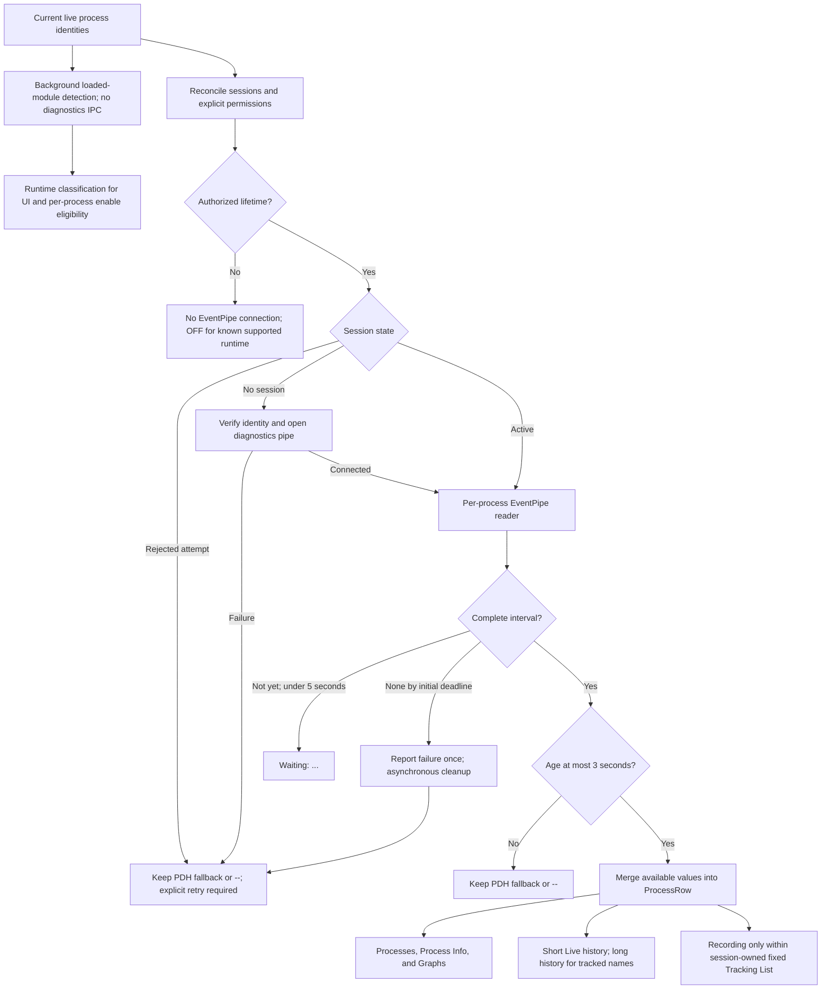
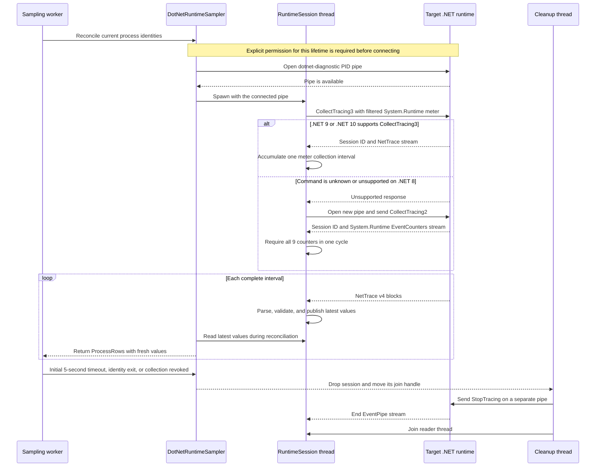

# .NET Runtime Metrics Collection

This implementation note explains how `winproc-tui` detects managed processes and collects the .NET runtime metrics exposed in the Processes table. Metric meanings, units, and recording fields remain normative in [metrics.md](metrics.md); runtime ownership and data flow remain normative in [architecture.md](architecture.md).

## Scope

EventPipe collection starts disabled on every run. After an explicit per-process n action, the live sampling worker attempts collection only for that authorized live process lifetime, regardless of Tracking List membership. A process is identified by `(PID, name, start_time)` so PID reuse cannot attach an old session or cached detection result to a new process.

| Target | Collection path | Available values |
|---|---|---|
| .NET 9 and .NET 10 | Diagnostics IPC, EventPipe, `System.Diagnostics.Metrics`, and the `System.Runtime` meter | All nine .NET columns when the runtime publishes complete intervals |
| .NET 8 | Diagnostics IPC, EventPipe, and `System.Runtime` EventCounters | All nine .NET columns when one complete EventCounter cycle is available |
| .NET Framework 4.8 | Legacy PDH `.NET CLR Memory` counters | `.NET Heap`, `.NET Gen1`, `.NET Gen2`, and `.NET LOH` |
| Native process or inaccessible managed process | No EventPipe session | Unavailable values (`--`) |

WinUI 3 is not detected as a special application type. A managed WinUI 3 process is supported when it runs on a supported .NET runtime and exposes the diagnostics pipe. A native-only WinUI 3 process does not expose these managed runtime metrics.

The initial synchronous startup sample does not open .NET sessions. EventPipe collection begins in the persistent live sampling worker only after explicit authorization. Log view does not run live .NET collection.

.NET Framework 4.8 does not expose a POH generation. Its PDH `Gen 0 heap size` counter is the maximum allocation threshold before the next Gen0 collection, not the current Gen0 heap occupancy represented by the modern runtime values. The collector therefore leaves Framework Gen0 and POH unavailable instead of placing semantically different data in those columns.

## Explicit authorization and startup safety

The Processes panel shows a gray-background N beside T when a loaded .NET 8+ runtime has been confirmed for that process lifetime. .NET Framework does not show this marker; its PDH metrics remain collected independently of the n action. A separate background worker examines loaded runtime modules without opening diagnostics IPC or starting EventPipe. Detection uses known creation times and checks identity before and after inspection; inaccessible or unknown runtimes are not positively marked. Positive detections are retained only for that lifetime; negative results are retried after ten seconds. This detection is live-only, independent of column visibility, and does not change recording schemas.

In Processes, n toggles metrics for the selected live process only, including untracked processes. Enabling requires a confirmed .NET 8+ runtime. Other processes, including instances with the same name, keep their own permissions. Exit and PID reuse revoke permission. Tracking changes and profile switches do not change existing collection permission. Turning one process off cancels its permit immediately and removes its session asynchronously; reenabling that same identity waits for both queued removal and its reader to finish. Other processes can continue collecting and can be enabled independently.

N turns pink immediately when an enable action is accepted, including initial connection and first-sample waiting. It remains pink while fresh metrics are collected, and returns to gray on disable, failure, or loss of fresh measurements after collection has started. Pink during startup acknowledges the request and does not prove that a sample has arrived. Log view and exited rows do not display a live N marker. Selection and repeated n key events must not accidentally toggle multiple processes; only one key press toggles the focused lifetime.

The COLUMNS dialog identifies the startup hang risk as a .NET 8/9/10 runtime issue and explains that choosing these columns changes visibility only. It also states that .NET Framework metrics are collected automatically. Its notice directs users to select a process and press n to start or stop collection. The former top-right .NET control is removed. Help and the Processes footer describe n and the marker meanings. Enable only after the target application has initialized: fixed delays do not prove readiness, and manual attachment during initialization can still hang the target.

Alt+N retains the existing bulk authorization dialog for compatibility. It opens with an unchecked Enable .NET metrics control holding keyboard focus. Space or clicking the control immediately toggles bulk collection; Enter and Esc close without changing collection state. The warning references dotnet/runtime Issue #119014. This legacy route remains separate from the primary per-process n action.

The legacy bulk confirmation freezes candidates from the current live snapshot whose names match the Tracking List, independently of display pause, filters, and column visibility. Matching uses the existing case-insensitive Tracking List rules and includes all matching live PIDs. An empty list or no identifiable live matches opens a visible guidance dialog. The enabled state is independent of the authorized target set: Space or a checkbox click can enable it even with zero targets, without granting any process connection permission. The runtime deadlock warning and upstream Issue reference remain visible in this state; guidance must never replace them. The guidance explains how to add a target to the Tracking List or start an existing tracked app, then retry. An enable attempt with no eligible identities checks the box and retains the guidance, but cannot start any connection. Subsequent samples, newly started processes, and Tracking List additions do not populate the empty authorization set. Enter or Esc closes it. If all captured targets become ineligible before activation, show the same guidance instead of silently rejecting the action. Candidates must have a known creation time and must still match when enabled and when the reader starts its request. New processes, same-name restarts, reused PIDs, and newly monitored targets never inherit authorization. To capture another set, turn collection off, close and reopen the dialog, then enable collection. Toggling within an open dialog never adds candidates beyond those captured when it opened. After authorization, removing a name from the Tracking List or switching profiles does not revoke its existing permits. The Tracking List limits only the candidates of this legacy bulk dialog, not individual n actions. Adding or re-adding a name never grants permission automatically. Profiles, saved settings, and recording actions cannot grant authorization.

Disabling cancels permits immediately. Already in-flight work drains asynchronously; the bulk dialog shows Stopping until the sampling worker acknowledges shutdown and all readers and cleanup tasks finish. Disabling an empty authorization set with no active readers requires no worker shutdown, so repeated toggles remain immediate. Re-enabling is refused while draining; an open dialog keeps its checkbox unchecked and displays the stopping state. If a target runtime does not respond, this may remain Stopping; the UI stays usable, and this is not a target-recovery mechanism. When a non-empty authorization set loses all targets through exit or removal, collection returns to disabled. An explicitly enabled empty set stays enabled until the user turns it off.

Process Info distinguishes Disabled, Not enabled, Waiting, Collecting, and Unavailable with a reason for EventPipe. Paused and log views describe their displayed/recorded data instead of presenting current collection status as historical state. Legacy PDH collection remains independent. An internal, non-serialized collection-generation marker allows the UI to discard queued EventPipe measurements after revocation without clearing ordinary PDH values. Existing history remains intact; subsequent absent measurements use the existing missing-value semantics.

Related runtime reports: [MetricsEventSource initialization deadlock](https://github.com/dotnet/runtime/issues/119014), [its fix](https://github.com/dotnet/runtime/pull/131501), and separate .NET 8 reports [#105682](https://github.com/dotnet/runtime/issues/105682) and [#118014](https://github.com/dotnet/runtime/issues/118014). A fix merged to runtime main does not establish that a supported servicing release contains it.

## No initial metrics

If a session publishes no complete metric interval within 5 seconds of its reader being created, the next sampling pass marks it Unavailable with a no-metrics timeout reason and requests asynchronous session cleanup. The process marker returns to gray and missing cells return to `--`; no automatic reconnect is attempted. Collection failures, including this timeout, show the process name, PID, and reason in the bottom status area once per authorization attempt. Repeated sampling does not overwrite later user messages with the same failure; Process Info retains the detailed status. The user can turn collection off and on to retry after cleanup. A session that has published data uses the existing freshness rules instead of this initial deadline.

A loaded supported CLR does not guarantee that managed diagnostic events are enabled. Applications can disable EventSource support (for example, `System.Diagnostics.Tracing.EventSource.IsSupported=false`) and therefore produce no metrics for the requested providers. A timeout reports the observed lack of metrics, not a definitive diagnosis of the target configuration. This collector deadline does not establish application readiness or recover a runtime startup deadlock. Target application configuration is never modified.

## End-to-End Flow

1. The one-second live sample builds the current `ProcessRow` list. A separate worker inspects loaded runtime modules and returns identity-checked runtime classifications without diagnostics IPC.
2. `DotNetRuntimeSampler::reconcile_and_apply` reconciles full `ProcessIdentity` values, removes exited identities, and checks explicit collection permission.
3. Only an authorized identity without an active or rejected session may open `\\.\pipe\dotnet-diagnostic-{pid}`. Runtime detection alone never opens this pipe.
4. Creation time and name are verified again before each session-start request, including protocol fallback. A connected session uses an independent `dotnet-runtime-{pid}` reader thread. Connection or session failure rejects the current attempt; an explicit off/on action after cleanup allows a retry.
5. The session requests a filtered, one-second EventPipe stream and parses the raw NetTrace v4 FastSerialization data in process.
6. An accumulator publishes only a coherent collection interval and retains the latest interval. If none arrives within five seconds of reader creation, the next sample reports failure and requests asynchronous cleanup.
7. The next live sample copies fresh values into the matching `ProcessRow`. An EventPipe value overrides its legacy PDH fallback only when that EventPipe value exists. Collection failures produce a bottom status message once per authorization attempt.

Loaded-module detection and collection are separate operations. Negative runtime detections can be checked again after ten seconds; failed collection attempts require explicit retry. Neither executable names nor application frameworks alone establish runtime support.

### Collection Flow



## Diagnostics IPC Session

`src/samplers/dotnet_runtime.rs` implements the required subset of the .NET diagnostics IPC protocol directly. It does not start `dotnet-counters`, load a profiler, inject code, or require a managed helper process.

Packets use the `DOTNET_IPC_V1` magic value and the runtime's named pipe. The first request attempts the newer CollectTracing command with explicit stack suppression and a single `System.Diagnostics.Metrics` provider. Its provider arguments are equivalent to:

```text
SessionId=SHARED
ClientId=winproc-tui-<target-pid>-<collector-pid>-<nonce>
RefreshInterval=1
Metrics="System.Runtime\dotnet.gc.heap.total_allocated;
         System.Runtime\dotnet.gc.last_collection.memory.committed_size;
         System.Runtime\dotnet.gc.last_collection.heap.size;
         System.Runtime\dotnet.gc.last_collection.heap.fragmentation.size"
MaxTimeSeries=32
MaxHistograms=0
```

The actual request encodes these arguments as one semicolon-separated UTF-16 string. Filtering at the provider limits the stream to the four instruments needed to derive the nine displayed values.

If the runtime reports the newer CollectTracing command as unknown or unsupported, the sampler opens a new pipe and sends the older CollectTracing command with only the `System.Runtime` provider and `EventCounterIntervalSec=1`. Protocol negotiation selects the supported collection path independently of the loaded-runtime classification used for per-process enable eligibility. It also avoids opening both modern and legacy counter sessions on a newer runtime.

## .NET 9 and .NET 10 Mapping

The `System.Diagnostics.Metrics` provider emits collection boundaries and instrument values for the filtered `System.Runtime` meter. Values are published at the collection-stop event.

| Display value | Instrument | Processing |
|---|---|---|
| `.NET Heap` | `dotnet.gc.last_collection.heap.size` | Sum `gen0`, `gen1`, `gen2`, `loh`, and `poh` |
| `.NET Gen0` | `dotnet.gc.last_collection.heap.size` | Use the value tagged `gc.heap.generation=gen0` |
| `.NET Gen1` | `dotnet.gc.last_collection.heap.size` | Use the value tagged `gc.heap.generation=gen1` |
| `.NET Gen2` | `dotnet.gc.last_collection.heap.size` | Use the value tagged `gc.heap.generation=gen2` |
| `.NET LOH` | `dotnet.gc.last_collection.heap.size` | Use the value tagged `gc.heap.generation=loh` |
| `.NET POH` | `dotnet.gc.last_collection.heap.size` | Use the value tagged `gc.heap.generation=poh` |
| `.NET Commit` | `dotnet.gc.last_collection.memory.committed_size` | Use the untagged value |
| `.NET Frag` | `dotnet.gc.last_collection.heap.fragmentation.size` | Sum `gen0`, `gen1`, `gen2`, `loh`, and `poh` |
| `.NET Alloc/s` | `dotnet.gc.heap.total_allocated` | Use the provider's rate value and round to bytes/s |

Heap and fragmentation are unavailable unless all five generations are present in the same interval. The sampler does not publish a partial sum because that would silently undercount the runtime value. The allocation rate normally needs a previous interval, so a newly opened .NET 9/10 session can take about two collection intervals before every value is visible.

## .NET 8 Mapping

The fallback reads these `System.Runtime` EventCounters:

| Display value | EventCounter | Conversion |
|---|---|---|
| `.NET Heap` | `gc-heap-size` | Decimal MB multiplied by 1,000,000 and rounded to bytes |
| `.NET Gen0` | `gen-0-size` | Use the byte value |
| `.NET Gen1` | `gen-1-size` | Use the byte value |
| `.NET Gen2` | `gen-2-size` | Use the byte value |
| `.NET LOH` | `loh-size` | Use the byte value |
| `.NET POH` | `poh-size` | Use the byte value |
| `.NET Commit` | `gc-committed` | Decimal MB multiplied by 1,000,000 and rounded to bytes |
| `.NET Frag` | `gc-fragmentation` | Percentage multiplied by the same cycle's heap size, then rounded to bytes |
| `.NET Alloc/s` | `alloc-rate` | Increment divided by the reported interval |

All nine counters must arrive in one logical cycle before the accumulator publishes values. If a counter repeats before the cycle is complete, the incomplete cycle is discarded and accumulation restarts. This prevents values from different refresh intervals from being combined.

## .NET Framework 4.8 Mapping

The persistent process PDH query reads the runtime instance's `Process ID` counter and joins values to the ordinary process rows by PID.

| Display value | `.NET CLR Memory` counter | Processing |
|---|---|---|
| `.NET Heap` | `# Bytes in all Heaps` | Use the byte value |
| `.NET Gen1` | `Gen 1 heap size` | Use the byte value |
| `.NET Gen2` | `Gen 2 heap size` | Use the byte value |
| `.NET LOH` | `Large Object Heap size` | Use the byte value |
| `.NET Gen0` | Not collected | The available `Gen 0 heap size` counter is an allocation threshold, not current occupancy |
| `.NET POH` | Not available | .NET Framework has no POH generation |

The .NET Framework PDH collection path is unaffected by the EventPipe startup deadlock addressed here. Supported Framework metrics continue to be collected automatically as before, without a per-process or bulk enable action. These PDH values remain available even though .NET Framework does not expose the .NET Core diagnostics named pipe. They use the same existing one-second PDH query as the other process counters and do not create per-process EventPipe threads.

## NetTrace Parsing and Validation

The collector reads the EventPipe stream directly rather than depending on a general-purpose trace library. The parser accepts NetTrace v4 FastSerialization objects, metadata blocks, event blocks, compressed and uncompressed event headers, and only the two providers needed by this feature.

Defensive limits include:

- a 16 MiB maximum EventPipe block;
- a 64-byte maximum FastSerialization type name;
- bounded UTF-16 strings;
- checked lengths, offsets, integer conversions, and generation sums;
- rejection of negative, non-finite, or invalid interval values.

An unsupported stream version, malformed block, truncated stream structure, or pipe failure ends only that process's runtime session. A malformed value payload is ignored. Neither case fails the complete process snapshot.

## Freshness, Retry, and Shutdown

- A published interval is applied only for three seconds. Older values become unavailable instead of remaining frozen indefinitely.
- A failed or ended session is not automatically retried. Its reason is available in Process Info; retry requires disabling and explicitly enabling collection again.
- Negative loaded-module detections are retried after ten seconds; positive detections are cached only for that process lifetime. This is separate from a rejected collection attempt, which is not automatically retried.
- Exited identities are removed on the next live reconciliation.
- Disabling collection or entering Log view revokes authorization immediately and sends `SuspendDotNet` when session cleanup is needed. An empty set with no readers needs no shutdown request. Returning to Live leaves collection disabled.

Stopping a session must not delay the sampling worker or the UI. Dropping `RuntimeSession` sets a stop flag, moves its join handle to a short-lived `dotnet-runtime-cleanup-{pid}` thread, opens a separate diagnostics pipe, and sends the EventPipe stop command using the stored session ID. The cleanup thread then joins the reader. An atomic guard prevents duplicate stop requests.

### Session Negotiation and Shutdown



## Display, History, and Recording Boundaries

Detection and current value display are independent of Tracking List membership. History and persistence remain intentionally asymmetric:

- only explicitly authorized live lifetimes may receive EventPipe values; legacy Framework PDH counters remain independent;
- non-tracked processes keep only the ordinary short live history;
- tracked processes keep the long live history;
- Recording includes only processes matching the session's fixed Tracking List;
- missing live .NET cells distinguish disabled (`OFF`) and first-sample waiting (`...`); unsupported metrics, unknown runtimes, failed collection, and other missing measurements retain `--`. These labels are presentation-only; object-based recording fields remain omitted and fixed-order schema positions use `null`.

## Expected Cost

The UI thread performs no diagnostics IPC or trace parsing. The one-second sampling worker performs identity reconciliation and copies the latest published values; each active authorized runtime session has a dedicated blocking reader thread.

The Issue #75 development benchmark used 20 idle .NET processes on a 20-logical-CPU machine. It measured the collector before three GC-rate values were removed; the current .NET 8 mapping requires the nine counters listed above. The benchmark observed:

- initial .NET 8 pipe detection in approximately 1.2-2 ms;
- all 12 .NET 8 values available after approximately 1.16 s;
- reconciliation after sessions were established over 1,000 calls at 4.6 microseconds p50, 4.8 microseconds p99, and 18.3 microseconds maximum per call;
- target-process overhead totaling approximately 0.42-0.86 CPU-seconds over 10 seconds across all 20 processes, or about 0.21-0.43% of total machine capacity;
- collector overhead of approximately 0.03% of total machine CPU capacity;
- collector growth of approximately 1.5 MiB working set and 1.9 MiB private bytes;
- asynchronous session stop completion in approximately 0.5-2.7 ms.

These figures are point-in-time development measurements, not a performance guarantee. The five generation-size EventCounters share the existing `System.Runtime` provider, one-second session, parser, and latest-value cache; they do not add sessions or diagnostic-pipe round trips. Active allocation or GC workloads can increase the target-side cost and emitted event volume. A .NET 9 process can require roughly 2.2 s for the complete first interval because rate instruments need the preceding interval.

## Maintenance Checklist

When changing this collector:

1. Keep metric definitions and units synchronized with [metrics.md](metrics.md).
2. Update both modern meter filtering and the relevant accumulator when adding an instrument.
3. Preserve complete-interval publication and missing-value semantics.
4. Keep pipe I/O and parsing outside the UI thread.
5. Keep shutdown asynchronous and bounded from the caller's perspective.
6. Check `model::columns`, `model::process`, `model::snapshot`, UI formatting, Process Info, clipboard output, history, and recording schemas.
7. Cover request encoding, parser bounds, version fallback, conversions, and lifecycle behavior with focused tests before running the full Rust test suite.

## References

- [.NET diagnostics IPC protocol](https://github.com/dotnet/diagnostics/blob/main/documentation/design-docs/ipc-protocol.md)
- [.NET runtime metrics](https://learn.microsoft.com/en-us/dotnet/core/diagnostics/built-in-metrics-runtime)
- [Well-known .NET EventCounters](https://learn.microsoft.com/en-us/dotnet/core/diagnostics/available-counters)
- [Mapping .NET Framework performance counters to modern metrics](https://learn.microsoft.com/en-us/dotnet/core/diagnostics/migrate-from-windows-performance-counters)
