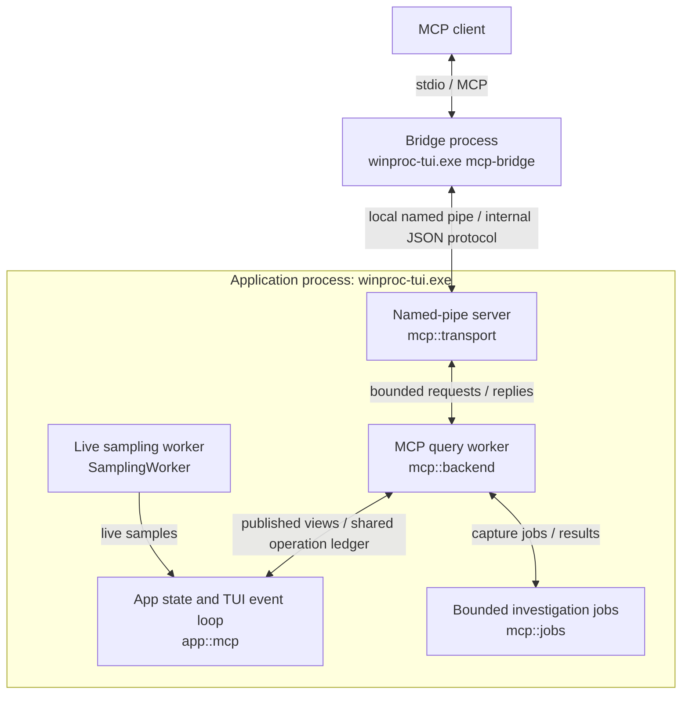
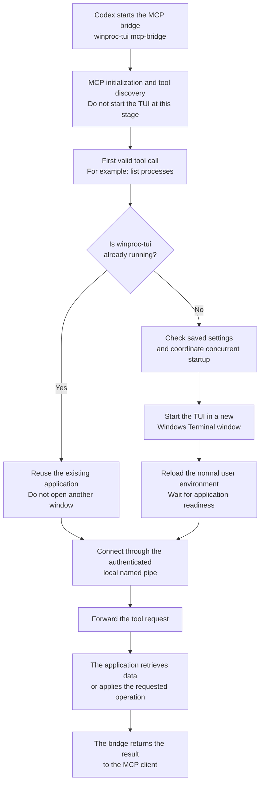
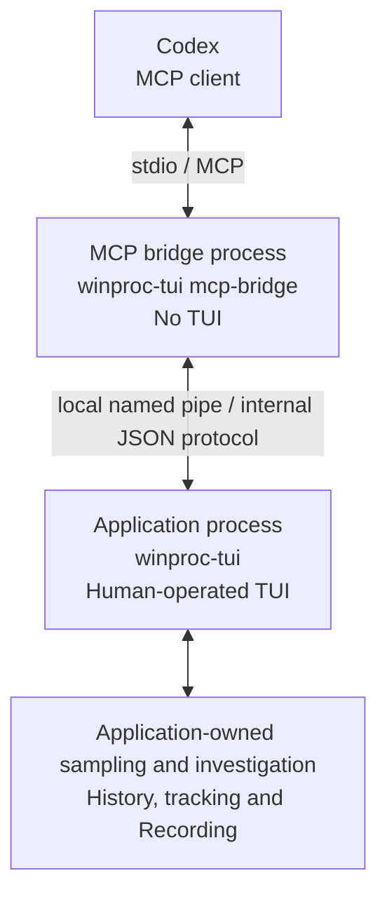

# WinProc MCP Integration Specification

Status: all 26 tool adapters implemented with local system verification under [Issue #202](https://github.com/TX230/winproc-tui/issues/202); not a released compatibility promise.
Date: 2026-11-01.
Scope: Windows 11 x64, winproc-tui, local MCP access through a stdio bridge and a named pipe.

## 1. Purpose and scope

The maintainer requires metrics retrieval, file investigation, compatibility with general MCP clients, and no TCP/IP transport for MCP communication, including the bridge-to-backend connection. This integration uses a small stdio bridge so ordinary stdio-capable MCP clients do not need a custom transport.

This document describes the current MCP implementation: client connection, the bridge, the application endpoint, exposed tools, state transitions, and interface limitations. It is a functional and interface specification, not a development plan. The bridge advertises all 26 adapters implemented under Issue #202. Section 12 lists release-verification criteria, not a claim that every check has passed. Observed results and remaining coverage are recorded in [MCP system testing](mcp-system-testing.md).

MCP is available by default during normal startup, with a persisted Settings control to disable connections and no activation CLI flag. The implemented feature set includes process and host inspection, metrics and history, file/module/network/thread investigation, tracking and Investigation Profiles, Recording control, saved-log analysis, explicit .NET collection control, and bounded condition waiting. Read and state-changing tools share one contract; their different authorization and lifecycle rules are defined below.

Goals:

- Let an AI client identify a process, inspect its resources and dependencies, find file users, and compare retained measurements.
- Reuse collection and identity checks without driving terminal controls.
- Keep sampling, Recording, and human interaction responsive.
- Preserve Windows access failures, incomplete coverage, and missing measurements as explicit evidence.
- Use only local stdio and local named pipes for MCP connection, discovery, and message delivery. This communication path has no HTTP listener, loopback socket, DNS lookup, remote pipe, or network fallback.

The transport restriction does not prohibit normal access to investigated files. Existing collectors may inspect executable, DLL, or open-file metadata on local disks, UNC shares, or mapped network drives under normal Windows permissions. Any resulting OS-managed network access is permitted; it is not an alternative MCP transport. Existing collection limits and failure reporting still apply. This does not add arbitrary file-content access to the tool catalog.

Out of scope: autonomous remediation, arbitrary commands, recursive disk indexing, file-content search, file-content reads, memory dumps, general handle exploration, remote management, or a Windows service.

“File search” means searching captured open disk-file/directory handles for processes using matching paths. It does not prove that a file is locked or that no other users exist.

## 2. Architecture

This section describes the implemented architecture. The normal application and the MCP bridge are separate processes of the same executable. The TUI and investigation engine have not been separated into independent hosts: the interactive application's `App` remains the owner of live state, history, tracking, profiles, Recording and local confirmations.



The bridge is the MCP server from the client's perspective. `mcp::bridge` owns MCP negotiation, tool schemas, input validation, cancellation mapping and result serialization. It does not collect Windows process data. `mcp::startup` reuses a running application or starts the normal TUI in a visible Windows Terminal window when eligible; section 3 defines that lifecycle.

Inside the application, `mcp::transport` runs the authenticated named-pipe listener on its asynchronous IPC thread. Its bounded request channel and reply channels connect it to the separate `mcp::backend` query worker. The internal JSON protocol is versioned independently of MCP; it is not an MCP-standard named-pipe binding or Microsoft RPC.

The query worker serves reads from immutable views published by `App::poll_mcp`, including the latest applied snapshot and shared history data. It owns connection-local references, captures and jobs. On-demand inspection uses bounded `mcp::jobs` workers that call existing collector functions. Collector-specific helper processes may be used; the diagram shows application ownership rather than every temporary helper.

State-changing requests go through the application-owned `mcp::operations` ledger. The TUI event loop calls `App::poll_mcp` to apply pending actions, check revisions and activity restrictions, and present any required local confirmation. Human input and MCP actions therefore modify the same application state. They share the working live investigation; connection-local captures and saved-log views remain separate. There is no independent service-layer host between the TUI and the state it controls.

MCP captures and requests have their own identities and do not drive TUI navigation or reuse Process Info dialog generations. Collection remains outside the bridge, and the `model` layer does not depend on MCP or terminal rendering. These boundaries reuse existing application and collector code; they do not imply a completed extraction into a standalone engine.

The bridge never requests elevation or starts a headless backend. Headless hosting and independent human/MCP ownership of the working live investigation are outside this specification. See [ADR 0004](adr/0004-visible-mcp-application-startup.md).

## 3. Startup and connection lifecycle

### 3.1. Startup scenarios at a glance

The difference between an absent application and an already-running application is whether the bridge needs to start the TUI. Once connected, both scenarios use the same request path and application-owned investigation services. Codex is shown as an example MCP client; other stdio-capable clients follow the same flow.



This diagram shows the successful paths. The detailed lifecycle below defines handshake ordering, startup eligibility, errors, cancellation and deadlines. In particular, an unavailable connection does not by itself prove that the application is absent.

After connection, the same executable runs in two separate roles: a bridge process without a TUI, and the interactive application process. When the bridge starts the application, Windows Terminal hosts its visible window.



| Aspect | Application not running | Application already running |
|---|---|---|
| Application startup | The bridge starts it when an eligible tool call needs it. | The bridge reuses it without starting another instance. |
| Window | A new Windows Terminal window displays the TUI. | The existing TUI remains in its current window. |
| Settings and history | Normal startup restores saved settings and begins collection; it does not restore a previous process's in-memory Live history. | Current runtime state and retained history remain available, subject to activity-specific restrictions. |
| Environment | Windows Terminal reloads the normal user environment instead of inheriting client-only terminal/color settings. | The application's existing environment is unchanged. |
| After MCP disconnect | The application and any active Recording continue. | The application and any active Recording continue. |

Connection/startup waiting is bounded by a total 12-second deadline. Saved MCP disablement blocks automatic startup; Terminal launch failure or failure to become ready also produces an actionable error. If the application is already running but cannot accept MCP connections, the bridge does not start a replacement. Neither communication link uses TCP/IP.

### 3.2. Detailed lifecycle

Normal `winproc-tui` startup enables the local MCP listener by default. No activation CLI flag is provided. Load the saved preference before creating the listener; the existing TUI single-instance rule remains unchanged. Both fresh configurations and older configurations without the new field use the enabled default.

Settings exposes a checkbox labeled `Disable MCP connections`. Unchecked means connections are enabled (default); checked means connections are disabled. Store it as the application setting `mcp_connections_disabled`, default `false`, in `winproc-tui.toml` beside the real executable using the existing configuration ownership and successful-exit persistence rules. Restore it on subsequent startup. It is not part of an Investigation Profile. Changing the checkbox takes effect immediately without restarting the TUI and is available in Live, Recording, and Log view; activity-specific tool restrictions still apply.

Checking the option first rejects new dispatches, then closes the listener and all accepted MCP connections, cancels MCP-owned read jobs, and releases their retained data. In-flight replies cannot repopulate invalidated sessions. Native cancellation may finish asynchronously under the existing bounded cleanup rules. Sampling, display state, and an active Recording continue unchanged. Unchecking starts a new listener; clients reconnect through a fresh handshake and cannot reuse references from closed sessions. Disabling is controlled locally through Settings, not through a remote MCP tool.

Listener creation or restart failure leaves the TUI usable and reports MCP as unavailable with a visible error. Preserve the requested setting rather than claiming successful availability or silently persisting a disabled preference. A quiet status indicator must distinguish configured availability, actual listener failure, and active connections. An unavailable pipe is reported as `BACKEND_UNAVAILABLE`. The bridge checks the application single-instance marker before considering launch, but cannot distinguish runtime disablement, a startup selection dialog, or listener failure from that marker alone. Its error must describe these possibilities rather than falsely report a specific runtime setting.

The activity header shows an `MCP` badge immediately before the activity label while at least one authenticated bridge connection has completed the internal handshake. It remains visible while that connection is idle and in every activity, and disappears after the last connection closes, listener failure, or local disablement. Listener availability and MCP tool discovery alone do not count as an active connection. Connection changes trigger a redraw even while display is paused or Log view has no incoming samples. At extremely narrow widths, the activity and freshness/pause labels take priority over the connection badge; Settings retains the detailed listener status.

Enabled but idle MCP only maintains the bounded listener; it does not start extra process inspection, EventPipe collection, file scans, or a model connection. Peer validation, same-logon restrictions, integrity checks, and resource limits apply equally to default-enabled startup. This default permits eligible local clients to request the exposed data; users who do not want that access can disable it in Settings.

Bridge command: `winproc-tui.exe mcp-bridge`. It performs no configuration writes beside the executable. This subcommand is implemented; there is no `--enable-mcp` option. The MCP client launches a separate bridge process from the same executable used by the TUI. Dispatch this subcommand before terminal initialization, configuration migration, and the TUI single-instance mutex.

Illustrative client configuration (the outer configuration key is client-specific):

```json
{
  "mcpServers": {
    "winproc": {
      "command": "C:\\Tools\\winproc\\winproc-tui.exe",
      "args": ["mcp-bridge"]
    }
  }
}
```

Each bridge process serves one MCP client and opens one backend connection. Limit: four backend client connections. Each connection has independent identifiers, cursors, captures, and jobs. Disconnect releases only its own objects.

The bridge can negotiate MCP, ping, list static tools, and reject invalid calls while the application is absent, without opening a window. The first schema-valid tool call uses the following connection/startup sequence:

1. Attempt the authenticated pipe handshake, with at most two seconds per attempt. Only a missing pipe permits considering startup. Access denial, peer/version mismatch, or an occupied pipe at capacity produces an error without replacement startup.
2. Inspect the existing Windows-session-local application single-instance marker without creating it. If present or inaccessible, never launch another application. An application already observed running is not replaced during this request, even if it subsequently exits.
3. Coordinate absent-application startup across bridges with a separate session-local launch marker. The winning bridge rechecks pipe and application presence after acquiring it; other bridges wait for readiness. The ordinary application mutex remains the final protection against a simultaneous manual launch.
4. Resolve the bridge's own executable and its real configuration location. Read the active configuration, or the legacy configuration that ordinary startup would migrate, without changing either file. If MCP is saved as disabled, or the configuration cannot be read/parsed safely, return an actionable error and require manual startup. A running application's current setting takes precedence over saved configuration.
5. Invoke the current user's Windows Terminal app execution alias with `-w new new-tab` and the absolute executable launch path as its command. Resolve aliases for configuration lookup but preserve the launch path so ordinary application startup can migrate a legacy launcher-adjacent configuration. Preserve literal paths including spaces, Unicode and semicolons. Override the profile command line and pass `--reloadEnvironment` so Windows Terminal creates a fresh user environment rather than copying client-only settings such as `NO_COLOR=1` or `TERM=dumb`. Preserve settings in the normal Windows user environment; do not globally force color or rewrite environment variables. Use the executable directory as working directory, and do not pass MCP stdio handles to the launcher. No shell command string, elevation request, hidden-window fallback, or additional executable is shipped.
6. Wait for the authenticated pipe handshake within a total 12-second connection/startup deadline. Launcher success is not backend readiness. A launcher error or deadline returns `BACKEND_UNAVAILABLE` with recovery guidance; do not repeatedly launch within the same request. Windows Terminal installation/alias availability and the user's Terminal profile are prerequisites for automatic startup. An incompatible or elevating profile may prevent connection; the integrity policy remains enforced.

A startup selection dialog remains interactive and may outlast the deadline. The user can finish it and retry; the bridge does not choose a profile or dismiss dialogs. Cancellation before launch prevents launch; once launch has been requested, retain coordination until readiness or the deadline, but never dispatch the cancelled tool. Process termination releases OS-owned markers; the ordinary single-instance rule still prevents duplicate samplers if a bridge crashes during launch. A manual-launch race or interruption before the application acquires its marker can leave a rejected extra terminal window; the bridge must not close unrelated windows.

Each successful pipe handshake returns the current listener's random backend instance identifier. Restarting the listener, including through Settings disable/re-enable, creates a new identifier and invalidates connection-owned process references, captures, jobs, loaded logs and cursors. Application-owned revisions, profile/session identifiers and retained operation outcomes survive listener restart while the application remains running. Reconnection is allowed on the next call, but never automatically replays an interrupted call.

Client stdin EOF closes the bridge connection and exits the bridge. Bridge exit, cancellation, MCP disablement, and client disconnect do not terminate the visible application or its Recording session. The user owns the application after launch and closes it normally. Backend exit fails pending work; it never terminates the client. Slow or disconnected clients must not block application shutdown.

### 3.3. When the user exits the TUI

A successful user-initiated application exit has the following effects, regardless of whether the application was started manually or by the bridge:

1. **The application stops; the MCP client and bridge remain running.** Live collection ends, application-owned in-memory state is released, and the named-pipe connection closes. Normal quit performs Recording cleanup and successful-exit configuration persistence. A cleanup failure can cancel quit; forced termination can leave a partial recording. See [Recording and log view](recording-and-log-view.md) for those shutdown rules.
2. **Exit alone does not trigger an immediate restart.** An idle bridge does not continuously monitor or restart the application. Initialization, ping, static tool discovery and invalid tool calls do not reopen the TUI.
3. **A stale connection is reported before reconnection.** If a bridge still holds the old pipe connection, the next valid tool call detects its loss, drops that connection and returns `OUTCOME_UNKNOWN`. A call already in flight that loses its connection before receiving a valid response has the same result. The bridge does not relaunch the application or replay that request as part of handling this failure. In particular, a state-changing operation may have taken effect before the reply was lost.
4. **A subsequent valid tool call may reopen the TUI.** Once the bridge has discarded the failed connection, the next valid call follows the startup procedure in section 3.2: reuse an application that is running again, or start an absent application in a new Windows Terminal window if eligible. A new bridge, or a bridge that never connected before the exit, can enter this procedure directly without first returning a stale-connection error. Saved MCP disablement and other startup checks still apply.
5. **Restart creates a new backend instance.** Previous live histories, captures, jobs, loaded-log handles, process references, cursors, revisions and operation outcomes do not survive application exit. Clients must obtain fresh references and revisions; querying an old operation ID returns `OPERATION_UNKNOWN`. Normal startup restores persisted settings and investigation state according to the configured startup mode. Saved recording files remain available for explicit reopening, but an interrupted Recording session is not automatically resumed.

Closing the TUI is therefore **not a persistent instruction to prevent future MCP startup**. If Codex or another MCP client subsequently calls a tool, the window can reopen under the rules above. To keep it closed, stop or disable the integration in the MCP client, or save `Disable MCP connections` in the TUI before a successful quit.

## 4. MCP compatibility

The bridge uses the Rust `rmcp` SDK and explicitly supports MCP revision `2025-11-25`. It does not advertise other revisions. Independent-client negotiation evidence and release checks are recorded in the system-testing document.

The SDK handles initialization, ping and request cancellation; the bridge implements `tools/list` and `tools/call`. Only the Tools capability is advertised. Resources, Prompts, model sampling, elicitation, subscriptions and experimental task features are not exposed.

All stdio output is valid UTF-8 newline-delimited MCP messages. Diagnostics use stderr and exclude captured values, command lines, paths, environment values, and raw requests. No banners, terminal escapes, progress bars, or application log lines go to stdout.

Every tool publishes an input schema and a common success/error output-envelope schema from [mcp-tools.json](schemas/mcp-tools.json). Inputs reject unknown fields. The output schema validates the envelope but leaves tool-specific `data` as an object; it does not enumerate every result field or capture-row shape. Structured results and a text block contain the same JSON. The encoded response limit includes both representations.

Tool annotations reflect actual behavior: read tools are read-only, including when file metadata inspection accesses a network share. Do not infer a closed-world annotation solely from the local-only MCP transport. Annotations are descriptive, not authorization. Capture creation allocates bounded ephemeral server state but does not modify investigated processes or files.

Long collection uses ordinary start/status/result tools and polling. No MCP Tasks support or progress notifications are implemented. Job status reports running or terminal state rather than percentage progress.

## 5. Named-pipe contract

Use a duplex byte-mode local pipe with overlapped I/O. Endpoint name:

```text
\\.\pipe\winproc-tui.mcp.v1.<logon-sid>
```

Derive the logon SID from the process token; do not accept arbitrary server names or UNC pipe paths from tool arguments. The version suffix denotes the private IPC major version.

Create the pipe with an explicit DACL restricted to the current logon SID, `PIPE_REJECT_REMOTE_CLIENTS`, and first-instance protection. Do not use the permissive default DACL. If an unexpected process already owns the endpoint, fail visibly rather than connecting to an arbitrary replacement.

Verify the peer's Windows token/logon session on acceptance; verify the server PID/token on bridge connection. Endpoint naming alone is not authentication. The connection policy requires matching integrity levels and refuses a lower-integrity bridge connecting to an elevated backend. No automatic elevation. Do not hold client impersonation across asynchronous work.

Same-session access is not isolation from other software running as the same user. Arbitrary same-user malicious processes are outside the security guarantee. Restricting a pipe does not stop the MCP client from forwarding returned data to its model provider.

Framing: a four-byte unsigned little-endian payload length followed by one UTF-8 JSON object. Maximum payload: 4 MiB. Read exactly the announced bytes, handle fragmented/coalesced reads, and reject zero-length, oversized, malformed, or invalid-UTF-8 frames before dispatch. One writer serializes each direction.

Handshake request fields: `kind: "hello"`, `ipc_major: 1`, `ipc_minor: 0`, and `bridge_version`. The `welcome` response includes `ipc_major`, `ipc_minor`, `backend_instance_id`, and `application_version`. After handshake, `winproc_get_status` exposes enabled operations and effective limits. Major mismatch fails the connection. The current handshake accepts the matching major without comparing minor or package-version strings; unknown fields are nevertheless rejected by message deserialization. A future wire extension therefore needs an explicit compatibility change rather than relying on minor-version acceptance.

After handshake, a `request` contains `request_id`, `method` and `arguments`; a `response` contains `request_id` and `result`, which may itself be an error object; a `cancel` contains `request_id`. IDs are nonempty strings of at most 128 bytes and must be unique among pending requests on that connection. Cancelling an unknown or finished ID has no effect. Unknown methods return `INVALID_ARGUMENT`; malformed framing, unknown envelope fields or invalid IDs close the connection. The serialized message definitions and framing tests are in `src/mcp/protocol.rs`, independently of MCP wire messages.

## 6. Common data contracts

### Identity and source

Public process references are opaque `process_ref` strings bound to the connection, backend instance, and full process lifetime. Return PID, name, and available creation time as descriptive fields, but never accept PID alone for a targeted collection or mutation. Native creation time is checked with a held handle before/after collection where required. Unknown creation time permits sampled information but not an unsafe live lookup; return `IDENTITY_UNVERIFIABLE`.

A process reference is not a promise of permanent retention. A restarted process obtains a different reference even if PID and filename are reused. A log process reference is bound to its log handle and recorded identity and can never target a live process.

Process listing, metric, and history calls select `source: "live"` or `source: "log"`. Process listing defaults to `"live"`; metric and history calls require the source explicitly. `"log"` also requires a connection-owned `log_ref` obtained by opening a saved log.

For live metrics, the source selects the latest applied sampling state, unaffected by display pause. For live history, it selects retained data from the current sampling session, including process lifetimes that have ended. In Log view live sampling is inactive: return `ACTIVITY_CONFLICT`, not loaded-log data labeled live. A log-source data query reads only its loaded recording and does not start an inspection collector. The initial backend connection can still start the normal application as described in section 3. Never switch the TUI activity to satisfy a read.

### Results and unavailable data

Common successful result fields:

- `api_version: "1.0"`, `backend_instance_id`, and `source`.
- `captured_at` for a snapshot, or `capture_started_at` / `capture_finished_at` for non-atomic collection.
- `status: "complete" | "partial"`, `warnings`, and tool-specific `data`.
- Paged results contain `data.capture_id`, `data.rows`, `data.next_cursor` and `data.coverage`. Catalogs and control-state getters are not paged.

Timestamp strings use RFC 3339 with an explicit offset, normally UTC; condition evidence can retain the application's local offset. Timeouts use a monotonic clock. `winproc_get_status` reports sample age and staleness at three seconds. Metric reads retain available values even when stale; callers inspect timestamps/status rather than expecting a per-value stale flag. Outside frozen capture/log queries, the common `captured_at` is the published snapshot timestamp, not the time a control action finished or host metadata was collected.

Metric values use raw units, not formatted TUI strings. CPU percent remains percent of total logical CPU capacity. The metric catalog declares identifier, target kind, unit, numeric representation, `source: "applied_samples"` and a general availability description; collector-specific meanings remain in [Metrics](metrics.md). Integer metric values and integer summary deltas use decimal strings to preserve exact values in JavaScript clients; percentages and finite floating values are JSON numbers. This rule is for metric quantities, not every integer field: PIDs, counts, durations and some process creation-time fields remain JSON integers. This API encoding does not change Recording schemas.

Metric reads and raw history omit unavailable values and put `"unknown"` in the corresponding `unavailable` map; these adapters do not derive detailed per-metric reasons from collector state. Process metadata uses its own `{value: ...}` or `{unavailable: ...}` field objects and can distinguish access denial and unsupported data. Missing measurements are not replaced with zero. No NaN or infinity is emitted.

Coverage is collector-specific, not a common exhaustive diagnostic model. File-user scans expose collector progress; open files expose handle counts and query failure; network exposes successful/failed table counts; threads expose an unavailable-thread count. Module, process-metadata and scheduling captures currently have no detailed coverage counters. A successful empty partial result is not an exhaustive negative finding.

### Filtering, pagination, and histories

Paging is available for process lists, raw history and retained captures, with `limit` defaulting to 100 and capped at 500. Process lists support filter, projection and ascending name/PID sort with identity tie-breakers. Capture reads support path filtering and projection but no sort option. Raw history has neither projection nor path filtering. Metric catalogs, profiles and tracking getters return their complete bounded state without paging. Ordinary query cursors bind the frozen capture and all supplied query arguments, including `limit`; changing arguments fails with `CURSOR_INVALID`. Unmodified `read_capture` is the exception: it slices the same capture and permits a different page size. Capture rows retain collector order unless their adapter explicitly sorts them.

Process filters support name/path substring and exact PID as discovery criteria. For `source: "live"`, `winproc_list_processes` accepts `scope: "live" | "retained" | "all"`, default `"live"`, with the following meanings. Recorded-source scope and lifecycle are defined in Section 10.

- `live` lists identities present in the latest applied process snapshot.
- `retained` lists identities with retained Live history, including both live and ended lifetimes.
- `all` returns the union, deduplicated by full process identity rather than PID or name.

Each unprojected live-source row includes `process_ref`, `lifecycle`, `last_seen_at` and retained history bounds when available. The current listing emits `live` for identities in the latest snapshot and `unknown` for history-only identities; it does not emit `exited` or perform an OS exit probe. Paths are available only from current snapshot rows, so a path filter excludes history-only identities without a path. Lifecycle describes evidence at the list capture time: a live sample is not a guarantee that the process is still running at invocation time. Use `unknown` when the application cannot establish lifecycle; do not infer an exit solely from an access failure. Listing reads existing snapshots and retained identity/history state without new inspection. It ignores TUI filters, Show exited, and individual Ghost Row hiding. It includes every identity retained by the existing retention rules, not only the newest visible Ghost Row.

Clients may obtain an ended process's reference after connecting and pass it to `winproc_get_history`. A reference to an exited target does not authorize static live inspection, open-file/module collection, or substitution of its last values as current metrics; reject that target with `PROCESS_EXITED`. Revalidate live targets before inspection. If retention pruning removes the referenced identity, subsequent history lookup returns `REFERENCE_INVALID` with guidance to refresh the list, without resolving by PID or name. Immutable list captures and pagination do not pin underlying history against pruning.

File filters reuse the existing case-insensitive all-term path matching, without filesystem traversal or regular expressions. A query against an existing file capture does not trigger another scan.

History calls take process/system target, metric identifiers, and an inclusive `[from, to]` interval. Evaluate a request against one immutable view of retained history. History queries support raw samples and per-metric summaries with these counts:

| Field | Definition |
|---|---|
| `sample_count` | Number of stored samples for the selected target whose timestamps fall inside the requested interval. |
| `available_value_count` | Number of those samples with an available finite value for the selected metric, including measured zero. |
| `missing_value_count` | Number of those stored samples without an available finite value for that metric. It equals `sample_count - available_value_count`. |

Compute min, max, arithmetic mean, and first/last available values with their timestamps using only available values. For integer metrics, encode the mean as an exact rational object with decimal-string `numerator` and `denominator`, without converting the sum to floating point. Endpoint delta requires available values at both exact requested endpoint timestamps. Omit unavailable statistics rather than returning zero; with no available values, min, max, mean, first/last values, and delta are unavailable. Means describe available samples, not time-weighted utilization. Do not interpolate or substitute nearest samples. No percentile or downsampling semantics are implied.

Temporal coverage contains `retained_from`, `retained_to`, `sample_count` and `max_sample_interval_ms` between adjacent stored samples within the request. Absent bounds or a gap with fewer than two samples are `null` metadata values. Summary mode returns these under `data.coverage`; raw pages return them under `data.temporal_coverage`, with paging information separately under `data.coverage`. Requested bounds, first/last stored timestamps within the interval and outside-retention portions are not separate response fields. Clients retain their request bounds and inspect raw timestamps when needed. Raw output preserves every stored timestamp, including samples whose selected metric is unavailable; gaps are not classified as outages.

Collection delays, periods with no stored target samples, time before process observation or after exit, and time outside retained coverage do not contribute to `missing_value_count`. Do not estimate a missing-sample count from the nominal one-second cadence, or infer the cause of a timestamp gap without evidence. If no stored samples fall in the requested interval, all three counts are zero and the result reports empty coverage, not an all-zero measured series. For example, four stored samples with values `10`, unavailable, `0`, and `20` produce counts of 4, 3, and 1 even if the request spans ten seconds. Summaries cover the complete requested interval in the frozen history view, not just one returned raw-data page.

Existing retention remains authoritative: approximately 120 samples for non-tracked identities, 7,200 for tracked identities and system history, plus existing identity-pruning rules. An MCP read does not extend retention, add tracking, or recover uncollected history. Only an explicit tracking action changes future retention capacity.

## 7. Tool interfaces

Names below are the implemented public tool names. The table summarizes essential inputs; [mcp-tools.json](schemas/mcp-tools.json) defines accepted arguments, enums, required fields and bounds. Defaults stated here are applied by the adapters, not necessarily expressed as JSON Schema `default` keywords. Output schemas describe the common envelope; tool-specific data is documented here and exercised by adapter/system tests. Clients discover names, descriptions, annotations and schemas through `tools/list`.

| Tool | Essential inputs | Result and behavior |
|---|---|---|
| `winproc_get_status` | none | Backend connectivity, version, activity, sampling age, permissions, enabled capabilities, limits; no process data. |
| `winproc_get_system_info` | none | Windows version/build and architecture from cached host information; CPU name/topology/cache and total memory from the published snapshot. No GPU inventory or fresh collection. |
| `winproc_list_metrics` | optional target kind | Canonical identifiers, units, exact-number encodings, and collection requirements. |
| `winproc_list_processes` | `source`, optional `log_ref`, `scope` (live/retained/all), filter, sort, paging | Immutable identity listing from the selected source, process references, lifecycle, last-seen/history bounds, verified/unknown parent relationship; no automatic extra collection. |
| `winproc_get_process_info` | `process_ref`, requested fields | Starts an asynchronous metadata job; poll its job ID and read its capture. Defaults to image/version; command line and user require explicit fields. Signature verification is reported unavailable. |
| `winproc_get_metrics` | `source`, optional `log_ref`, system/process targets, metric IDs | Values from one latest applied live sample or the final recorded frame; no forced sampling. Maximum 50 targets total, including system targets. |
| `winproc_get_history` | `source`, optional `log_ref`, target, metric IDs, interval, `mode` | Raw series or summary from retained live or loaded log data, including ended lifetimes; stored-sample/value counts and separate temporal coverage; paging and exact timestamps. |
| `winproc_start_capture` | `kind`, optional `process_ref` | Starts `file_users`, `open_files`, `modules`, `network`, `threads`, or `scheduling`; returns a connection-owned job ID promptly. File users is host-wide; Network supports host-wide or per-process capture; other kinds require a live process reference. |
| `winproc_get_job` | `job_id` | `running`, `succeeded`, or `failed`; result reference (`capture_id` or `log_ref`), condition evidence, or explicit error. Cancellation and timeout are failed outcomes with `CANCELLED` / `TIMEOUT`; limited useful results carry partial status and coverage. |
| `winproc_read_capture` | `capture_id`, filter, projection, paging | Retained immutable investigation rows and coverage for the requested capture kind; no collection. |
| `winproc_cancel_job` | `job_id` | Requests cancellation without changing an already terminal outcome; inspect job status for the result. |
| `winproc_release_capture` | `capture_id` | Releases caller-owned retained results; idempotent. |

File-user rows include process reference when verified, PID/name, full path and handle count. Open-file rows currently expose `path`, decimal-string `handle`, `kind` and optional decimal-string `size_bytes`. Access/mode attributes, file timestamps and individual metadata failures are not exported by this adapter; aggregate handle/query failures appear in coverage. A handle value is capture-local information, never a persistent handle identifier. Module rows contain path, name, directory, company, product/file versions and modified-time metadata; individual metadata fields may be unavailable even when enumeration status is complete.

Process listing is flat. Clients may construct a tree from `parent` references. The current `verified` label means the latest snapshot has exactly one candidate with the recorded parent PID and a creation time strictly earlier than the child; otherwise the parent is `unknown`. It is a snapshot consistency check, not a separate historical ancestry query.

Sensitive static fields such as command line and user are opt-in through field projection; default process listings exclude them. Environment values are outside this specification.

The following interfaces complete the investigation workflow. State-changing requests include `operation_id` for deduplication and the applicable `expected_revision` or recording-session identifier; Section 10 defines their shared behavior.

| Tool | Essential inputs | Result and behavior |
|---|---|---|
| `winproc_get_tracking` | none | Current working process names, investigation revision, and matching live identities; `winproc_list_profiles` supplies the active profile binding. |
| `winproc_update_tracking` | `action` (add/remove), `process_name` or `process_ref`, operation fields | Changes one name in the working Tracking List, returning the resulting revision and affected scope; no implicit profile save. |
| `winproc_list_profiles` | none | Saved Investigation Profiles, profile references, revisions, and their tracked names. |
| `winproc_update_profile` | `action` (load/save/save_as/rename/delete), applicable profile reference/name, operation fields | Explicit profile operation; no UI selection changes, silent overwrite, or unconfirmed history pruning. |
| `winproc_get_recording` | none | Active flag, session ID, fixed tracked names, interval, output-log ID, and whether an output directory is configured (not a filesystem readiness probe). Elapsed time and the latest completed outcome are not returned by this getter; inspect the start/stop operation outcome with `winproc_get_operation`. |
| `winproc_start_recording` | `interval_seconds` (1/2/5/10), operation fields | Starts one application-owned recording using the current nonempty Tracking List and the configured output directory. |
| `winproc_stop_recording` | `recording_session_id`, operation fields | Explicitly requests stopping that exact session, subject to confirmation and flush/close results. |
| `winproc_list_logs` | optional filename filter; cursor for an existing listing | Starts a directory-listing job; poll it, then page its capture with `winproc_read_capture`. Rows contain `log_id` and `name`; file size, dates and format validation are not returned. No unrestricted pathname parameter. |
| `winproc_open_log` | `log_id` | Starts a bounded background load job; successful completion returns `log_ref` without changing TUI activity. |
| `winproc_close_log` | `log_ref` | Releases a connection-owned loaded log and its dependent cursors/references; idempotent. |
| `winproc_get_dotnet_collection` | `process_ref` | Runtime support (`supported`), authorization (`enabled`), collection revision, disabled/waiting/collecting/stopping/unavailable state, and safe diagnostic detail. This getter does not return a runtime-family classification or a separate collection-freshness field. |
| `winproc_set_dotnet_collection` | `process_ref`, `enabled`, operation fields | Explicit per-lifetime collection change; tracking and metric queries do not grant permission. |
| `winproc_wait_condition` | condition, target, `timeout_ms` | Starts a bounded job for process appearance, verified exit, or a metric threshold; returns observed evidence or timeout. |
| `winproc_get_operation` | `operation_id` | Application-owned action state (`pending`, `pending_confirmation`, `succeeded`, or `failed`) and outcome. |

Example MCP call using the implemented `private_bytes` metric:

```json
{"jsonrpc":"2.0","id":12,"method":"tools/call","params":{"name":"winproc_get_metrics","arguments":{"source":"live","targets":[{"process_ref":"opaque-process-reference"}],"metric_ids":["private_bytes"]}}}
```

Illustrative structured result inside the MCP tool result:

```json
{
  "api_version": "1.0",
  "backend_instance_id": "opaque-instance-id",
  "source": "live",
  "captured_at": "2026-10-31T03:00:00Z",
  "status": "complete",
  "warnings": [],
  "data": {
    "samples": [{
      "target": {"process_ref": "opaque-process-reference"},
      "values": {"private_bytes": "268435456"},
      "unavailable": {}
    }]
  }
}
```

## 8. Jobs, limits, and failures

Implemented limits; release coverage is recorded in the system-testing document:

| Resource | Limit |
|---|---|
| Connected bridge instances | 4 |
| In-flight internal protocol requests per connection | 8; the shipped bridge permits only one concurrent tool call and returns `BUSY` for another |
| Active collection jobs per connection | 2 |
| Global MCP worker slots | 8, including native capture, log and condition jobs; occupied until worker cleanup finishes |
| Job records per connection | 64 running/completed entries combined, until expiry |
| Log directory results / remembered log IDs | 5,000 rows per listing; exceeding 5,000 remembered IDs requires reconnecting |
| Global file-user scans | 1 across TUI and MCP |
| Retained captures and loaded logs per connection | 8 combined |
| Retained result budget | 64 MiB per connection (at most 256 MiB across four connections), counting serialized capture rows and conservative loaded-log reservations, including log child captures |
| Capture / loaded-log lifetime | 5 minutes after completion; reads do not renew it |
| Completed job metadata lifetime | 5 minutes |
| Page size | 100 default, 500 maximum, reduced to fit encoded response budget |
| MCP complete encoded message / pipe payload | 4 MiB each |
| Internal response deadline | 10 seconds after connection; up to 12 seconds for connection/startup is additional |
| Collection / log-load job deadline | 60 seconds; existing stricter collector limits take precedence |
| Condition wait deadline | Caller-specified, 1 through 60,000 ms |
| Pending MCP state-changing operations | 1 application-wide; reject excess MCP requests with `BUSY` without blocking TUI input |
| Operation outcome retention | 24 hours in application memory; reserve at most 1,024 operation entries and reject new operations if full |

Queue/worker saturation returns `BUSY`; retained-object or byte limits return `RESOURCE_LIMIT` or `RESULT_TOO_LARGE`. Collectors that return useful bounded results can report partial coverage, but a job deadline normally fails with `TIMEOUT` and exceeding the retained-byte budget fails instead of returning a truncated capture. A single row exceeding the encoded page budget returns `RESULT_TOO_LARGE`. The retained-result budget is not a bound on total application heap, temporary serialization/copies or all in-flight collector allocations.

Before backend dispatch, cancellation returns `CANCELLED`. After dispatch, the shipped bridge closes the pipe on MCP cancellation or its response timeout and reports `OUTCOME_UNKNOWN`; it does not send the internal protocol's `cancel` message. This disconnect also invalidates other connection-owned data. Once a start call has returned a job ID, use `winproc_cancel_job` to cancel that job without dropping the connection. Disconnect requests cancellation of all connection-owned jobs. A native call already executing may not be immediately cancellable; report cancellation requested and pending cleanup honestly. Reuse the isolated file-search helper and bounded job cleanup; never kill the investigated process to cancel collection.

Distinguish request/protocol errors from tool validation and execution errors:

- Invalid JSON or JSON-RPC request structure, unknown methods/tools, and requests that fail the MCP `CallToolRequest` envelope schema use protocol-level errors.
- For a recognized tool with a valid call envelope, failures of its `inputSchema` or semantic validation use a tool result with `isError: true` and application code `INVALID_ARGUMENT`. Examples include a missing required tool argument, an unknown argument field, an invalid date, reversed time bounds, an invalid enum, or a limit outside the documented range. Do not turn these failures into protocol errors merely because validation runs in the bridge.
- Other tool execution failures also use `isError: true`, with the applicable application error code. Partial useful captures remain successful tool results with explicit warnings and coverage.

Each tool output schema must allow its structured success and error variants. Error results include the same safe error data in `structuredContent` and serialized text JSON. Bridge schema-validation errors include `field` and `constraint` JSON Pointers into the arguments and input schema without echoing sensitive input. The message is generic; clients resolve the constraint against the schema from `tools/list` to obtain the type, format or bound. Backend semantic-validation errors can instead contain a safe explanatory message without those pointers. Input-schema failure in the bridge dispatches no work and cannot trigger application startup. Semantic checks performed by the backend require a connection, so a schema-valid but semantically invalid call can already have started the application.

Application error codes currently emitted by the exposed paths:

`OUTCOME_UNKNOWN`, `RESOURCE_LIMIT`, `COLLECTION_FAILED`, `INVALID_ARGUMENT`, `BACKEND_UNAVAILABLE`, `ACCESS_DENIED`, `IDENTITY_UNVERIFIABLE`, `PROCESS_EXITED`, `IDENTITY_CHANGED`, `ACTIVITY_CONFLICT`, `UNSUPPORTED`, `BUSY`, `TIMEOUT`, `CANCELLED`, `CURSOR_INVALID`, `REFERENCE_INVALID`, `RESULT_TOO_LARGE`, `STATE_CONFLICT`, `PERMISSION_DENIED`, `OPERATION_UNKNOWN`, `INTERNAL_ERROR`.

Errors include `code`, safe `message` and `retryable`. The output schema permits `native_error_code`, but current adapters do not populate it. Connection/handshake failures, including version mismatch, map to `BACKEND_UNAVAILABLE`. Expired captures use `REFERENCE_INVALID` or `CURSOR_INVALID` depending on the access path. `retryable` indicates whether an unchanged call may succeed on retry; it is `false` for `INVALID_ARGUMENT`, which requires correction first. Never include environment contents or echo an entire request. Connection loss after a state change can leave its outcome unknown. Query the operation outcome after reconnection; never infer failure from disconnection or automatically repeat the change.

Connection-wide accounting includes child captures of every loaded log and pending log slots. Recheck capacity when asynchronous results complete, because other queries may consume capacity while a job runs. Derived pages share the same connection budget; rejection preserves existing captures. Log queries replace the previous child-byte contribution with the new contribution rather than adding both.

Job and operation polling distinguish retrieval success from execution success: a successful getter can return `data.state: "failed"` with an error under `data.result.error` while MCP `isError` remains false. The outer envelope's status/timestamp is not the job outcome or completion time. Clients must inspect the nested state/result; completed capture metadata is returned by `read_capture`.

An unmodified `read_capture` reads the existing frozen object without allocating a new capture, changing its creation time, or invalidating the originating list/history cursor. Its page size controls only response slicing. Filter/projection changes create separately budgeted derived captures.

## 9. Activity and TUI coexistence

| Operation | Live | Recording | Log view | Display paused |
|---|---|---|---|---|
| Status / catalogs / host info / operation status | Yes | Yes | Yes; cached host and last Live sample, independent of the displayed log | Yes |
| Live-source listing / metrics / history | Yes | Yes | Reject | Uses current sampling state and retained history |
| Live file / module / network / thread / scheduling inspection | Yes | Yes | Reject | Allowed with identity checks |
| Tracking and profile inspection | Yes | Yes | Yes; working names/profiles and matches from the last Live sample | Yes |
| Tracking add/remove; profile load/save/save_as | Explicit authorized call | Reject | Reject | Same activity rules; no dependence on displayed selection |
| Profile rename/delete | Explicit authorized call | Explicit authorized call | Explicit authorized call | Same activity rules |
| Recording start | Explicit authorized call | Reject duplicate start | Reject | Uses current Tracking List |
| Recording stop | No active session | Confirm exact session | No active session | Recording continues until confirmed stop |
| Saved-log reads | Yes | Yes | Yes | Independent of displayed data |
| .NET collection control / live condition waits | Yes | Yes | Reject | Uses verified live identity/current samples |

MCP reads do not change focus, selected row, filters, Graphs, A/B positions, active profile, or display pause. Explicit tracking, profile, recording, and .NET actions change their owned application state and are reflected by the TUI without selecting a different process or opening an investigation view. Multiple clients cannot overwrite each other's inspection sessions. Applying results checks connection, backend instance, request/job identity, target lifetime, activity, and state revision as applicable.

TUI Log view stores its displayed recording separately from the last Live snapshot. General getters continue to describe application-owned state and cached host information with `source: "live"`; their timestamp and snapshot-derived host fields never come from the displayed recording. Tracking matches likewise refer to the last Live sample, not recorded process rows. Live sampling is suspended in Log view, so these matches are not a fresh OS liveness check; `get_status.activity`, sample age and the original timestamp expose that distinction. Dedicated `source: "log"` queries read independently opened recordings.

A transition to Log view cancels MCP-owned live investigation and condition-wait jobs and invalidates live capture cursors. No new live work is dispatched in Log view. Pending native work may finish, but results are discarded. Independent saved-log handles remain usable. A published snapshot is copied or shared immutably with bounded lifetimes; collectors never hold the UI state lock during Windows calls.

## 10. Investigation and state-changing behavior

### Tracking and Investigation Profiles

The working Tracking List contains case-insensitive process names, not PIDs. Adding via `process_ref` resolves its captured name and explicitly reports that all matching live and future instances are in scope. Adding via `process_name` permits tracking before a matching process starts. Exactly one of these target forms is accepted. Existing normalization rules apply; adding an existing name or removing an absent name is a successful no-op.

Tracking increases the existing Live history capacity from 120 to 7,200 samples per matching lifetime, approximately two minutes to two hours at normal cadence. It does not restore discarded data, persist metrics to disk, start Recording, or grant .NET collection authorization. Separate same-name lifetimes retain separate histories. The mutation outcome includes effective tracked names, name-based scope and the new revision; obtain matching identities separately through `winproc_get_tracking`. Tracking changes use the Current Investigation and successful-exit persistence rules; they neither alter Tracked-only nor implicitly save a named profile.

Removal and profile loading use the existing retention/pruning rules. If an operation would discard older retained history, present the exact affected names and discard scope for confirmation before applying it. Profile load replaces only the working tracking intent and profile binding; it does not replace Graphs or app settings. Profile save/save_as/rename/delete are explicit operations governed by the existing profile persistence rules. A duplicate destination name is a conflict, not implicit overwrite. Profile save applies only to the active profile; save_as requires a new name. Loading also confirms before replacing different unsaved working tracking state, even without history loss. Deleting a saved profile always requires local confirmation. Inspecting a profile never loads it.

### Recording

Start requires a nonempty working Tracking List but permits zero matching live processes. Snapshot the names and selected 1/2/5/10-second interval into the application-owned recording session. Start does not silently add tracked names, stop another session, change display pause, or switch out of Log view. Return a unique recording session ID, fixed scope, interval, and output-log ID.

A stop request targets that exact session and preserves the existing stop confirmation semantics: recording continues until confirmed. Stale requests cannot stop a replacement session. Confirmed stop flushes a partial aggregation window, writes the end record, flushes and closes the writer. Report completion only after the result is known. Errors remain visible in the TUI and in operation status; preserve partial logs. The existing 24-hour duration limit and quit-cleanup rules remain authoritative.

Once started, Recording belongs to the application, not the bridge connection. Disconnecting, disabling MCP, or cancelling a client wait does not stop it. Tracking mutation and profile load/save remain unavailable during Recording. Recording is metric-only; file/module/network/thread reports are not silently added to its schema.

Output uses a locally configured recording directory and a generated filename with create-new semantics. Return server-issued log IDs rather than accepting arbitrary overwrite paths. A missing output-directory configuration produces a clear prerequisite error without starting Recording. UNC or mapped directories are permitted under normal Windows access rules.

### Saved-log analysis

List the single configured log root and open by server-issued log ID. The configured root is the local Recording last-directory setting; configure it through a TUI recording before using MCP Recording or log listing. Directory listing selects regular files with a `.log` extension and an optional case-insensitive filename substring. It does not validate their recording format until opening. Listing returns a job whose capture contains log IDs and names; its initial `limit` does not cap collection. Use `read_capture` for page sizing. Opening a log returns a load job whose successful result contains `log_ref`. An open request creates a connection-owned read-only load job with bounded memory and duration. Support the same recording schemas as the application, retain complete readable frames from interrupted recordings, and report parse failures and incomplete sessions explicitly. Exceeding the memory budget fails the load; it must not silently shorten a recording. Loading an MCP log does not enter TUI Log view or stop sampling/Recording.

`source: "log"` queries require `log_ref`. For process listing, `scope: "live"` means present in the final recorded frame, `"retained"` means any identity with loaded history, and `"all"` is their union. These are recorded membership states, not current OS liveness: log-source list responses use `source: "log"` and `lifecycle: "unknown"`. Rows expose `last_seen_at` and available `history_from`/`history_to`, not separate first/last-seen fields. Never check current process existence to fill a log row. Metric reads return the final recorded frame; history reads use the requested interval. Available/missing counts refer to stored recording frames for that identity, using the same per-metric definitions as live history. The recording interval is returned as source metadata; no one-second samples are invented for aggregated logs.

Saved-log process rows are normalized to recorded-source semantics before they are frozen or projected: their lifecycle is `unknown`, including identities present in the final frame. Direct queries and generic `read_capture`, including subsequent pages and filtered/projected captures, preserve the same `source: "log"`, `log_ref`, recording interval, capture timestamp/interval, partial status and warnings. An interrupted recording makes every successful query/read partial; its warning is merged with capture warnings without duplication. Projection selects row fields only and cannot remove source-level metadata. Closing or expiring the log invalidates both direct queries and dependent captures.

Log references cannot target live inspection, tracking-by-reference, or .NET controls. File/module/network/thread/environment data absent from the recording is unavailable, not collected live. Comparison is performed by querying the desired sources/intervals and comparing their explicit timestamps and summaries; there is no implicit TUI A/B state or playback. Closing, expiry, disconnect, or disabling MCP releases the loaded log and invalidates its references. Loaded histories are bounded by the MCP result budget rather than Live retention capacities. The loader reserves 1 MiB for its reader plus conservative per-record and expanded-definition costs before reconstruction; its reservation can reject a source that would fit under an exact heap measurement. It preserves every complete readable frame or fails the load, never silently reduces history.

### Network, threads, and scheduling inspection

Network captures read local Windows endpoint tables without DNS lookups, active connection attempts, traffic capture or endpoint modification. Coverage exposes successful and failed table counts, not per-table names/error details. Capture start/finish timestamps cover the non-atomic query. Rows contain protocol, local/remote endpoint, PID, optional owner name and state; they do not export owner process references.

Threads and scheduling are explicit read-only captures of a fixed verified live identity. Threads expose TID, base priority and available name, CPU seconds and ideal CPU. Scheduling exposes available priority class, affinity masks and EcoQoS policy; absent fields are omitted without per-field error reasons. Scheduling status currently depends on priority-class availability, so `complete` does not guarantee every optional field is available. These captures do not add normal-sampling fields or recording data, or change scheduling policy.

### .NET collection

Collection control is an explicit authorization for one verified live process lifetime, independent of tracking and profile membership. Enabling requires the existing supported-runtime and initialization-readiness confirmation; a loaded CLR or a fixed delay does not prove safe readiness. No client-supplied confirmation boolean bypasses that confirmation. Enabling MCP or reading .NET metrics does not enable EventPipe.

Collection status distinguishes authorized/waiting, collecting, unavailable, and stopping. Revocation prevents new work immediately; asynchronous reader cleanup must finish before re-enabling that lifetime. The existing runtime-specific failure, freshness, and no-automatic-retry rules apply. Framework PDH collection remains independent. Accepted authorization belongs to the application and follows its existing collection lifecycle; bridge disconnection does not implicitly toggle it. No live .NET collection runs in Log view. No permission is restored from configuration or inherited by a restarted process.

### Bounded condition waiting

Condition waits use a caller-specified deadline and a connection-owned job. Supported conditions are a process name being present in a sample newer than the request's initial snapshot, a verified lifetime exiting, or a selected metric satisfying an explicit comparison threshold in a newer sample. Appearance and threshold waits test presence/comparison, not an absent-to-present or threshold-crossing transition; an already-present process can satisfy the next sample. Exit waits instead poll a held verified process handle. Evaluate metrics on fresh applied samples; missing/stale values do not satisfy a threshold. Access failure is not proof of exit. Conditions report the actual observation and timestamp; the one-second sampler cannot guarantee detection of short-lived events between samples. No wait starts additional sampling or creates a persistent watcher. Disconnect, cancellation, expiry, or entering Log view ends the wait.

### Shared action semantics

Revisions are opaque process-instance-prefixed counters. The implementation conservatively shares one revision across investigation, profiles, and collection authorization, so an unrelated edit can require a client to refresh. Profile operations other than `save_as` require both the profile ID and its reported revision. All mutation calls return an operation handle promptly; poll `winproc_get_operation` for completion. Pending confirmation is displayed in a scrollable local overlay. Error codes distinguish a conflict, cancellation, timeout, or execution failure even when the enclosing operation state is `failed`.

Investigation state changes are explicit tool calls, never side effects of reads. Connection establishment can start the normal visible application as described in section 3, including its ordinary startup sampling and persistence lifecycle. Each action carries a unique `operation_id` and an expected revision for the state it changes (investigation/profile/collection), or the exact session ID for recording stop. The backend serializes shared-state changes and checks activity, identity, permissions, and revisions immediately before application. Read operations return the corresponding revisions; profile load/save check both the investigation revision and the selected profile revision, while save_as/rename check destination-name uniqueness. Changes by the TUI or another client invalidate stale requests with `STATE_CONFLICT` rather than silently overwriting state. Recording start also checks the current investigation revision and absence of an active session.

The backend enforces applicable local authorization and confirmation requirements. When confirmation is required, return `pending_confirmation` with an immutable action description and let the local TUI record the human decision; do not require client elicitation support or accept an AI-supplied `confirmed: true`. Recheck revisions and target identity after confirmation. Sampling and Recording continue while an action waits. The 60-second confirmation timeout is measured from action submission, not from the first overlay draw, and reports `TIMEOUT`; requesting-client disconnect, MCP disable, or local refusal produces `CANCELLED`. Already accepted application-owned state is not rolled back on disconnect.

The same operation ID and identical request return the retained status/outcome without repeating effects; reuse with different arguments is rejected. Operation status is owned by the application, accessible after reconnection in the same authorized logon context using that operation ID, and separate from connection-owned inspection jobs. It survives Settings disable/re-enable for the stated retention period, independently of the listener's backend instance ID. After application restart or expiry return `OPERATION_UNKNOWN`; callers must inspect actual application state before explicitly deciding whether to submit a new operation. No automatic retry follows an uncertain outcome. A state revision or identifier is not a substitute for OS identity checks.

Environment values, process termination, priority/affinity/EcoQoS mutation, file launching, Explorer actions, arbitrary memory reads, arbitrary commands, and filesystem-content tools are outside this specification. There is no generic action-execution escape hatch.

## 11. Distribution and documentation boundaries

Ship the bridge as the `mcp-bridge` subcommand of `winproc-tui.exe`, not as a second executable or separately versioned package. Share protocol/model code rather than duplicating collectors, and retain the IPC compatibility check because a running backend can predate an on-disk upgrade. The bridge uses a separate command path and never enters terminal, config migration, or application single-instance startup.

Keep the runtime zip contents as `winproc-tui.exe` and `LICENSE`. WinGet retains its portable ZIP and existing `winproc-tui` command alias; no second executable entry or separate MCP package is required. Other distribution routes deliver the same subcommand with the application. The executable must satisfy the Windows x64 static CRT policy. Distribution verification covers both interactive and bridge startup modes under the existing release workflow.

This document owns the external MCP contract. Architecture owns application responsibility boundaries; process-investigation owns Windows collector behavior; metrics owns measurement meanings; tracking and recording documents own their respective product state. MCP-specific interfaces and controls follow those contracts except for the explicitly described external-session behavior. Installation and first-use guidance belongs in the two READMEs, complete UI controls in Help/Footer, and release procedure in the release workflow. The executable exposes the implemented contracts described here; release suitability still requires the conformance checks below.

## 12. Conformance criteria

See [MCP system testing](mcp-system-testing.md) for reproducible checks, observed results, and remaining coverage. Frozen pages preserve their stored capture metadata and originating sample timestamp or collection interval. Derived filtered views inherit the original capture expiry rather than renewing it. Reading an existing unfiltered capture must not require another capture slot.

The following are release-verification criteria for the current interface and its documented limitations. They are not implementation phases or evidence that every environment has passed:

1. A protocol harness and at least two independent stdio-capable MCP clients can negotiate, list tools, and complete a process/metrics/file investigation. Record actual client names, versions, and supported protocol revisions in verification results.
2. MCP connection, discovery, message delivery, and fallback paths use only local stdio and local named pipes, with no TCP/IP listener, outbound connection, or DNS lookup for those paths; remote named-pipe access is rejected. Normal investigated-file access, including metadata on UNC shares or mapped network drives, is allowed and must not be treated as a transport violation. Verify that successful and failed network-file inspection follows the same permissions, coverage reporting, and collection limits as local-file inspection. Existing OS-table observation is not MCP network transport.
3. Foreign logon sessions and integrity-level mismatches cannot access data. Endpoint squatting fails closed. Peer verification and DACLs have negative tests.
4. Protocol tests cover fragmented/coalesced pipe frames, oversized data, invalid UTF-8, malformed JSON, version mismatch, EOF, cancellation races, and a client that stops reading.
5. Tool input/output fixtures validate against the committed schemas; integer precision, missing values, empty partial captures, success/error variants, and text/structured parity are covered. Malformed call envelopes and unknown tools produce protocol errors; recognized-tool argument failures (including missing/unknown fields, invalid dates, enums, and bounds) produce `isError: true` results with `INVALID_ARGUMENT`. Input-schema rejection in the bridge dispatches no backend work; semantic rejection is checked after connection. Corrected arguments can succeed on a subsequent call.
6. PID reuse, process exit during inspection, missing creation time, backend restart, and references from another connection/log do not retarget a request. A client connecting after a process exits can discover its reference through `winproc_list_processes` with `scope: "retained"` or `"all"` and then read its retained history, independent of TUI Ghost Row visibility. Test scope overlap/deduplication, unknown lifecycle, and retained generations. Exited references reject live inspection/current-value substitution, and a pruned identity fails explicitly rather than resolving to a reused PID.
7. Pagination stays stable while processes change; changed filters and expired cursors fail explicitly. A query change against a capture performs no new file scan.
8. All limits are exercised. A slow or inaccessible file provider cannot block TUI polling or sampling, and cancellation/cleanup status stays truthful.
9. Display pause does not freeze MCP live values. Log view rejects live investigation, and late worker replies cannot escape that restriction.
10. History tests cover unavailable endpoints, irregular sampling intervals, retention pruning, restart generations, exact integer values, and raw versus summary agreement across pages. Per-metric counts include only stored target samples: measured zero is available, unavailable/non-finite values are missing, and uncollected time, absent-process intervals, and time outside retained bounds add no missing values. Verify the four-sample example, empty/all-unavailable intervals, separate temporal coverage, and omission of statistics with no available values.
11. Concurrent clients and TUI investigations preserve independent results and bounded global collection. Bridge disconnect leaves ordinary sampling and Recording intact.
12. A repeated workload compares MCP enabled/disabled behavior: no MCP collection executes on the UI or sampling thread; request load remains bounded, and regressions in sample latency are measured and resolved before release.
13. Package checks verify MCP-only bridge stdout, compatibility failure behavior, required runtime files, and static CRT linkage. Verify lazy visible Windows Terminal startup, literal executable paths, concurrent bridges sharing one backend, reuse of an existing application, saved-disabled and runtime-disabled behavior, absent/failing Terminal, bounded readiness timeout, cancellation, and application survival after bridge EOF. Initialization, discovery and invalid calls must not launch an application.
14. Normal startup enables MCP for fresh and older configurations. The Settings checkbox applies immediately in every activity, persists on successful exit, and restores before listener creation. A saved disabled setting creates no listener. Re-enabling requires fresh connections; disabling rejects queued work and stale replies without interrupting sampling or Recording. Listener failures remain visible and do not prevent TUI use. No activation CLI flag is exposed.
15. Tracking by name and by process reference reports the same name-based scope. Same-name instances retain separate histories; addition does not recover discarded data or start .NET collection/Recording. Removal/profile load confirms applicable history loss. Concurrent TUI/client changes reject stale revisions, and duplicate operations do not repeat effects.
16. Recording uses fixed names and interval, permits zero current matches, enforces activity restrictions and the 24-hour limit, and flushes before reporting stop completion. Disconnect does not stop recording. A stale stop cannot affect another session. Partial-log errors remain observable.
17. Loaded MCP logs do not change TUI activity or sampling. Schema compatibility, aggregated timestamps, interrupted files, memory limits, source-bound process references, and explicit closure/expiry are covered. Missing live-only investigation data is never collected to supplement a log.
18. Network/thread/scheduling captures remain read-only and expose partial coverage. .NET collection requires per-lifetime authorization/readiness confirmation, respects asynchronous stop, and never transfers permission across restart. Condition waits use fresh evidence, obey cancellation/deadlines, and do not infer exit from access failure.
19. Required confirmations preserve normal application operation, expire or cancel as specified, and revalidate before application. Operation status survives bridge reconnection within the backend retention window; unknown outcomes are not automatically retried.

Representative completed workflow: find a process, explicitly add its name to the Tracking List, observe its metrics and retained history during a reproducible workload, investigate files/modules/network as needed, explicitly record a reproduction, stop and inspect the saved log, then disconnect without changing TUI selection or silently undoing accepted investigation state.

## 13. References

Existing product contracts:

- [Architecture](./architecture.md)
- [Process investigation](./process-investigation.md)
- [Tracking and history](./tracking-and-history.md)
- [Metrics](./metrics.md)
- [Recording and Log view](./recording-and-log-view.md)
- [.NET collection](./dotnet-metrics-collection.md)
- [Release workflow](./release-workflow.md)

External protocol and platform references:

- [MCP 2025-11-25 transports](https://modelcontextprotocol.io/specification/2025-11-25/basic/transports)
- [MCP 2025-11-25 lifecycle](https://modelcontextprotocol.io/specification/2025-11-25/basic/lifecycle)
- [MCP 2025-11-25 tools](https://modelcontextprotocol.io/specification/2025-11-25/server/tools)
- [Windows named-pipe security and access rights](https://learn.microsoft.com/en-us/windows/win32/ipc/named-pipe-security-and-access-rights)
- [CreateNamedPipeW](https://learn.microsoft.com/en-us/windows/win32/api/winbase/nf-winbase-createnamedpipew)
